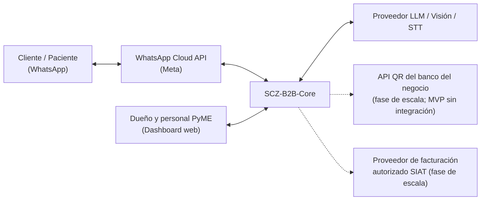
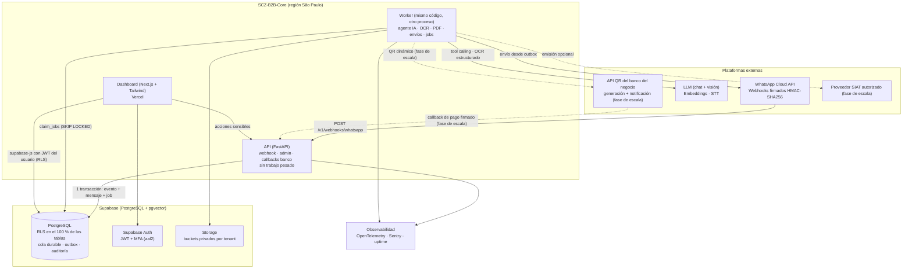
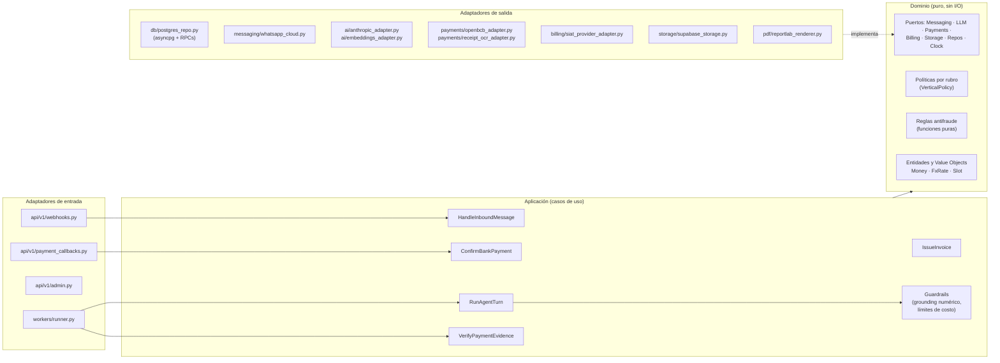
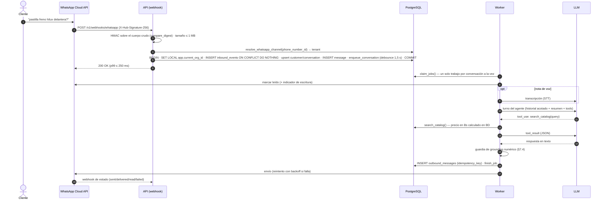
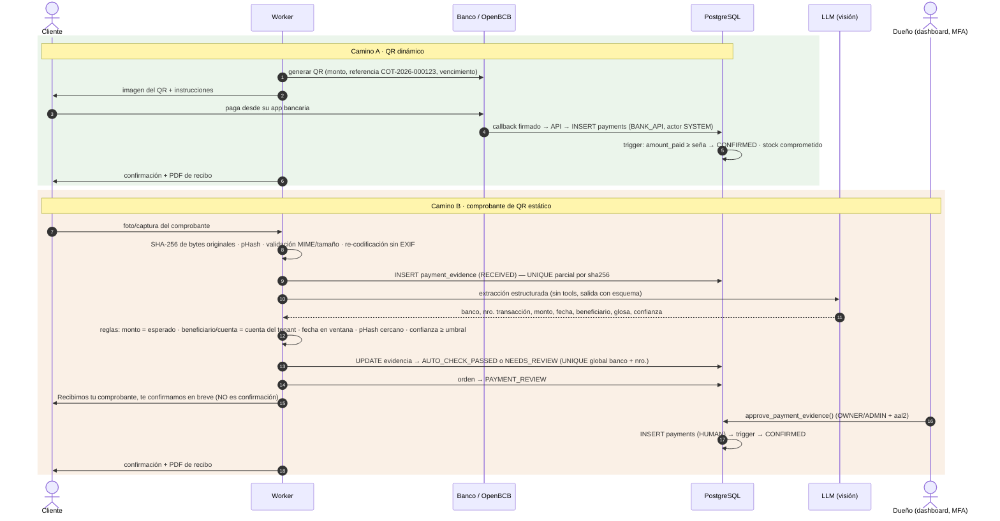
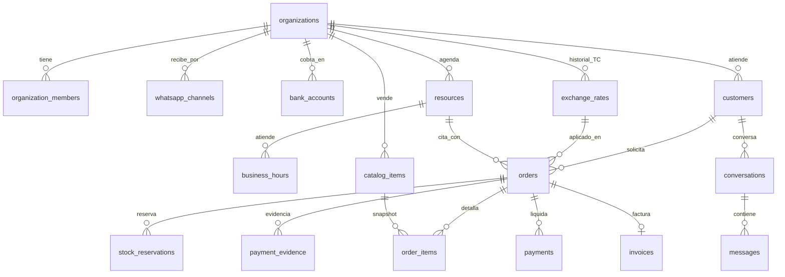
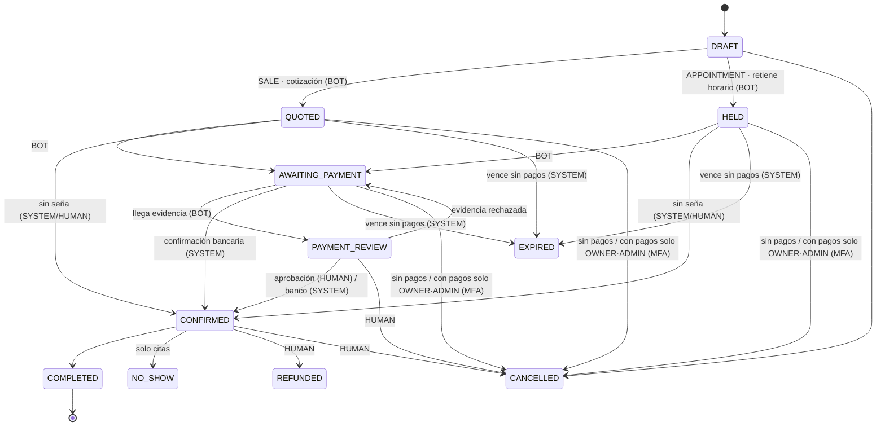

# SYSTEM_DESIGN.md — SCZ-B2B-Core

**Motor transaccional multi-tenant de atención, cotización, agendamiento y conciliación de pagos QR por WhatsApp**

| Campo | Valor |
| :--- | :--- |
| Proyecto | `scz-b2b-core` |
| Autora / Arquitecta principal | Adriana Hernández Severich (AHS) |
| Mercado inicial | Santa Cruz de la Sierra, Bolivia |
| Versión | **2.2** (15-oct-2026) — reemplaza a la v1.0 |
| Estado | Propuesta para revisión (ver `docs/reviews/2026-10-15-revision-system-design-v1.md`) |
| Decisiones | `docs/adr/` (ADR-0001 … ADR-0020) |
| Marco legal y negocio | `docs/legal/marco-legal-y-modelo-de-negocio.md` |
| Requisitos | `docs/requirements/SRS.md` (RF-xx) · arquitectura y UML en `docs/architecture/` |
| Esquema ejecutable | `supabase/migrations/` (20 migraciones) — **fuente única de verdad del modelo de datos** |
| Pruebas del esquema | `supabase/tests/database/` — 297 pruebas pgTAP en 18 archivos, ejecutadas en CI con `supabase test db` sobre la imagen oficial de Supabase (PostgreSQL 17, `supabase/config.toml`) |
| Restricciones externas | `docs/research/2026-10-15-restricciones-externas.md` (EXT-01 … EXT-17) |

> **Cómo leer este documento.** §1–3 explican *qué* y *por qué*; §4–7 describen *cómo funciona*; §8–11 cubren *seguridad, rendimiento, operación y costos*; §12–13 son la guía para construirlo con calidad. Cada afirmación crítica apunta a la migración o prueba que la demuestra.

### Historial de cambios

| Versión | Fecha | Cambio |
| :--- | :--- | :--- |
| 1.0 | 15-oct-2026 | Especificación base (AHS). |
| 2.0 | 15-oct-2026 | Revisión de ingeniería: 30 hallazgos corregidos (13 confirmados ejecutando el SQL v1). RLS también para el backend, modelo de confianza de pagos, cola durable, FSM en BD, historial de tipo de cambio, búsqueda híbrida real, conversaciones y handoff, seguridad/privacidad, SLOs, costos, CI y pruebas. |
| 2.1 | 15-oct-2026 | Investigación de restricciones externas: IVA por régimen (Ley 1733, ADR-0012), la plataforma no custodia fondos (ADR-0013), APIs QR bancarias y OpenBCB, cobro de mensajes de servicio de WhatsApp, política de IA de Meta, TC flotante. SRS, principios SOLID, patrones y UML. |
| 2.2 | 15-oct-2026 | **Alcance de mínimo regulatorio** (ADR-0014): MVP con QR estático del negocio y aprobación humana, sin OpenBCB, sin facturación, sin comisiones por transacción, sin pedir CI/NIT por el chat, onboarding de WhatsApp en modelo directo, importadoras primero, opt-in y opt-out. |

---

## 1. Contexto y alcance

### 1.1 Problema

Las PyMEs de alto flujo transaccional de Santa Cruz —en particular **importadoras de repuestos / ferreterías industriales** y **clínicas odontológicas / consultorios**— concentran su embudo comercial en WhatsApp y comparten tres cuellos de botella:

1. **Datos desestructurados y riesgo cambiario.** Inventarios y aranceles viven en planillas o PDFs. En 2026 el riesgo es mayor que cuando se escribió la v1: el tipo de cambio oficial dejó de ser fijo (el BCB publicó un **TC oficial de 11,68 Bs/USD el 15-oct-2026**, frente a los 6,96 históricos), así que una cotización con un TC desactualizado puede venderse con pérdida.
2. **Conciliación manual y fraude en pagos QR.** El personal verifica capturas de comprobantes a ojo, y quedan expuestos a comprobantes duplicados, adulterados o fabricados, además de demoras para liberar pedidos y turnos.
3. **Doble carga fiscal.** El cierre comercial ocurre por WhatsApp y la factura del SIAT se emite aparte, a mano.

### 1.2 Alcance

| En alcance (MVP) | Fuera de alcance (MVP) |
| :--- | :--- |
| Atención por WhatsApp (texto, imagen, nota de voz) con agente IA y traspaso a humano | Otros canales (Instagram, web chat) |
| Catálogo con búsqueda híbrida, cotización en Bs con TC vigente y reserva de stock | ERP/inventario completo, compras, multi-almacén |
| Agenda por profesional/recurso con seña | Historia clínica electrónica |
| Pagos: QR estático **del propio negocio** + comprobante + reglas + aprobación humana (ADR-0014) | Pasarela de tarjetas; custodia de fondos; comisiones por transacción; OpenBCB |
| Dashboard: catálogo, TC, órdenes/agenda, bandeja de pagos, bandeja de conversaciones | App móvil nativa |
| Rubro inicial: importadoras y ferreterías; clínicas (solo agenda) después del piloto | Facturación SIAT (fase de escala, vía proveedor autorizado contratado por el negocio); conector a la API del banco del negocio (fase de escala); homologación propia ante el SIN |

### 1.3 Supuestos y restricciones

* **Canal:** solo la **WhatsApp Business Platform (Cloud API) oficial** de Meta (ADR-0006). Aplican la ventana de atención de 24 h y las plantillas aprobadas.
* **Moneda:** las operaciones se liquidan en **bolivianos (BOB)**. Los precios de lista pueden estar en USD y se convierten con el TC vigente del tenant. Desde el 26-jun-2026 el régimen cambiario es **flexible**: el BCB publica el TCO cada día hábil.
* **IVA:** hoy el 13 % está incluido en el precio (Ley 843). La **Ley 1733** lo pasa a "por fuera" cuando rija su reglamento (pilotos del SIN entre el 1-oct y el 16-nov-2026). El modelo soporta ambos regímenes (ADR-0012).
* **Pagos:** la plataforma **no custodia fondos**. Las pasarelas y fintech de pagos requieren autorización de la ASFI, así que el dinero va directo a la cuenta de cada negocio (ADR-0013).
* **Política de Meta:** desde el 15-ene-2026 están prohibidos los chatbots de IA de propósito general. El agente se limita a la atención del negocio. Para conectar los números de los clientes hay que ser *Tech Provider* de Meta.
* **Zona horaria:** `America/La_Paz` (UTC−4, sin horario de verano). Se guarda todo en `timestamptz` y se presenta en la hora local del tenant.
* **Datos personales:** a sep-2026 Bolivia **no tiene ley general de protección de datos personales** (existen anteproyectos y la acción constitucional de protección de privacidad). El diseño adopta igualmente buenas prácticas de privacidad por diseño (§8.7).
* **IA:** el Proyecto de Ley N.º 178/2024-2025 (uso de IA) fue aprobado por el Senado y estaba en revisión en Diputados a jun-2026. El diseño ya cumple sus obligaciones previsibles: aviso de interacción automatizada y revisión humana de decisiones que afectan derechos.
* **Equipo:** pequeño (1–3 personas). Esto favorece un monolito modular, servicios gestionados y pocas piezas móviles.

---

## 2. Requisitos de calidad medibles (ISO/IEC 25010)

La v1 decía "todo al 100 %". En ingeniería esto se separa en dos clases de garantía:

* **Garantías deterministas (100 %, verificadas por pruebas):** aislamiento entre tenants, aritmética monetaria, transiciones de estado, no doble reserva, no sobreventa, idempotencia. Se cumplen **por construcción** (restricciones del motor) y se prueban en CI.
* **Desempeño probabilístico (medido, con objetivo y plan de mejora):** comprensión del lenguaje natural, OCR de comprobantes, elección de herramientas por el LLM. Nunca es 100 %. Por eso ninguna de estas salidas puede, por sí sola, mover dinero ni confirmar un pedido.

| ID | Atributo | Escenario / métrica | Objetivo | Verificación |
| :--- | :--- | :--- | :--- | :--- |
| Q-SEC-1 | Seguridad · aislamiento | Filas de otro tenant visibles o escribibles por cualquier rol de runtime (`app_backend`, `authenticated`, `anon`) | **0** | pgTAP `01_tenant_isolation` (21 pruebas) en cada PR |
| Q-SEC-2 | Seguridad · webhook | Peticiones sin firma `X-Hub-Signature-256` válida procesadas | **0** | Prueba de seguridad + test de contrato |
| Q-ACC-1 | Exactitud · dinero | Diferencia entre total cotizado y Σ(cantidad × precio unitario) recalculado | **0,00 Bs** | pgTAP `02_*` + pruebas de propiedades (Hypothesis) |
| Q-ACC-2 | Exactitud · estados | Orden `CONFIRMED` con `amount_paid_bs < deposit_required_bs` | **0** (imposible por trigger) | pgTAP `02_*` |
| Q-ACC-3 | Exactitud · agenda/stock | Citas solapadas por recurso / stock reservado > disponible | **0** (EXCLUDE + bloqueo de filas) | pgTAP `03_*` + prueba de concurrencia |
| Q-ACC-4 | Exactitud · OCR | Coincidencia exacta por campo (monto, nro. de transacción, banco, fecha) sobre ≥ 200 comprobantes bolivianos etiquetados | monto ≥ 99 %, resto ≥ 97 % | Suite `evals/ocr` |
| Q-ACC-5 | Exactitud · agente | Herramienta y argumentos correctos sobre la suite de conversaciones *golden* por vertical | ≥ 95 % | Suite `evals/conversations` |
| Q-ACC-6 | Exactitud · respuesta | Montos en Bs dichos por el bot que no provienen de una herramienta | **0** (guardia de *grounding* numérico, §7.4) | Unit + evals |
| Q-PERF-1 | Rendimiento · ack webhook | Tiempo en servidor desde la recepción hasta el `200 OK` | p99 ≤ 250 ms | Métrica `webhook_ack_ms` |
| Q-PERF-2 | Rendimiento · respuesta texto | Desde la recepción del último mensaje de la ráfaga hasta el envío aceptado por Meta | p50 ≤ 5 s · p95 ≤ 8 s | Métrica `reply_latency_ms` |
| Q-PERF-3 | Rendimiento · comprobante | Desde la recepción de la imagen hasta el acuse al cliente ("recibido, en verificación") | p95 ≤ 15 s | Métrica `evidence_latency_ms` |
| Q-REL-1 | Confiabilidad | Mensajes entrantes aceptados (200 OK) que nunca se procesan | **0** (persistencia antes del ack + reintentos + DLQ) | Prueba de caos: matar el worker a mitad de un trabajo |
| Q-REL-2 | Disponibilidad | API de webhook (mensual) | ≥ 99,5 % | Uptime check externo |
| Q-REL-3 | Recuperación | RPO / RTO | RPO ≤ 24 h (≤ 5 min con PITR) · RTO ≤ 4 h | Simulacro de restauración trimestral |
| Q-MAINT-1 | Mantenibilidad · multi-rubro | Agregar un rubro nuevo sin modificar `domain/` ni `application/` | Solo `verticals/<rubro>/` + config validada | Revisión de arquitectura + pruebas de contrato |
| Q-MAINT-2 | Mantenibilidad · calidad | Cobertura de `domain/` + `application/`; `mypy --strict` y `ruff` sin errores | ≥ 85 % · 0 errores | CI |
| Q-COST-1 | Costo | Costo de IA por tenant y mes, medido en `private.llm_calls` | Tope configurable por plan; alerta al 80 % | Dashboard de costos |

---

## 3. Decisiones de arquitectura (resumen)

El detalle (contexto, alternativas, consecuencias y verificación) está en `docs/adr/`.

| ADR | Decisión | Cambio respecto a v1 |
| :--- | :--- | :--- |
| [0001](docs/adr/0001-monolito-modular-hexagonal.md) | Monolito modular hexagonal en Python (FastAPI), desplegado como **dos procesos**: API (webhook + endpoints) y Worker | Separa el worker; se mantiene el monolito |
| [0002](docs/adr/0002-multitenancy-rls-tambien-backend.md) | Multi-tenancy lógico con **RLS aplicada también al backend** (rol `app_backend` sin BYPASSRLS + `SET LOCAL app.current_org_id`) y **FK compuestas** | v1 usaba *service role*, que ignora RLS |
| [0003](docs/adr/0003-busqueda-hibrida-rrf.md) | Búsqueda híbrida en PostgreSQL: FTS + SKU/trigram + vector, fusionadas con **RRF** | v1 no usaba el FTS y ordenaba mal los NULL |
| [0004](docs/adr/0004-fsm-en-base-de-datos.md) | **FSM aplicada por el motor** (tabla de transiciones por actor + invariante de pago) | v1 la tenía solo en Python |
| [0005](docs/adr/0005-cola-durable-postgres.md) | **Cola durable en PostgreSQL** (`FOR UPDATE SKIP LOCKED`) + outbox; descarta `BackgroundTasks` | v1 podía perder mensajes |
| [0006](docs/adr/0006-solo-whatsapp-cloud-api.md) | **Solo WhatsApp Cloud API oficial**; descarta Evolution API | v1 dejaba ambas |
| [0007](docs/adr/0007-dinero-y-tipo-de-cambio.md) | Cálculo monetario en **una sola función SQL**; **historial de TC** append-only; cotizaciones con vigencia | v1 duplicaba el cálculo y fijaba 6,96 |
| [0008](docs/adr/0008-modelo-de-confianza-de-pagos.md) | **QR dinámico con confirmación bancaria** como camino preferido; el comprobante + OCR es *evidencia* y exige aprobación humana. **MVP: solo el camino B** (QR estático, ADR-0014) | v1 confirmaba con el pre-chequeo de IA |
| [0009](docs/adr/0009-facturacion-siat-por-adaptador.md) | Facturación SIAT vía `BillingPort` + proveedor homologado | Se mantiene; se agrega la entidad `invoices` |
| [0010](docs/adr/0010-despliegue-y-region.md) | Cómputo co-ubicado con la BD (São Paulo); worker *always-on* | v1 dejaba Cloud Run o Railway sin restricciones |
| [0011](docs/adr/0011-acceso-a-datos-transaccional.md) | El backend accede a Postgres directo (asyncpg vía Supavisor) para transacciones; la lógica crítica vive en RPCs | v1 asumía `supabase-py` (PostgREST, sin transacciones) |
| [0012](docs/adr/0012-iva-por-regimen-vigente.md) | **IVA por régimen vigente** (incluido o adicional), congelado en cada orden | v1 no modelaba el IVA |
| [0013](docs/adr/0013-la-plataforma-no-custodia-fondos.md) | **La plataforma no custodia fondos**: QR a nombre de la cuenta de cada negocio | Nuevo (riesgo regulatorio ASFI) |
| [0014](docs/adr/0014-alcance-de-minimo-regulatorio-para-el-mvp.md) | **MVP de mínimo regulatorio**: QR estático + aprobación humana, suscripción fija, sin facturación ni datos de identidad por chat | Nuevo (viabilidad comercial) |
| [0015](docs/adr/0015-ciclo-de-vida-de-reservas-de-stock.md) | La vigencia de una **reserva de stock** la decide el estado de la orden; un trigger compromete, libera o devuelve el stock en cada transición | Nuevo (revisión del 15-oct-2026: sobreventa) |
| [0017](docs/adr/0017-envio-a-lo-sumo-una-vez-ante-resultado-incierto.md) | **Envío a lo sumo una vez ante un resultado incierto:** el mensaje se marca `SENDING` antes de llamar a Meta; si el worker muere durante la llamada, el reintento no reenvía: `FAILED (OUTCOME_UNKNOWN)` con alerta | Nuevo (#18) |
| [0018](docs/adr/0018-proveedor-de-llm.md) | **Anthropic como único proveedor de IA del agente**, sin comparación entre proveedores (costo y cuentas extra); modelo inicial Claude Haiku 5.5 (confirmado); calidad medida con las evals de #28 | Nuevo |
| [0019](docs/adr/0019-gemini-para-pruebas-de-desarrollo.md) | **Gemini (plan gratuito) solo para pruebas de desarrollo:** `LLM_PROVIDER=gemini` no arranca en staging ni producción; solo datos sintéticos; Anthropic sigue en producción | Nuevo (#83) |
| [0020](docs/adr/0020-busqueda-con-sinonimos-sin-embeddings.md) | **Búsqueda con sinónimos por rubro, sin embeddings por ahora** (decisión de AHS): `search_synonyms` expande la consulta de texto; no se encolan `EMBED_ITEM`; el recuperador vectorial queda inactivo | Nuevo (#23) |
| [0016](docs/adr/0016-mfa-mixto-para-precios-del-catalogo.md) | **Regla mixta de MFA para precios:** cambios dentro del umbral sin MFA; precio 0, cambio de moneda o variación mayor al umbral del negocio, solo OWNER/ADMIN con aal2; el backend no cambia precios | Nuevo (riesgo residual de SEC-01, #50) |

---

## 4. Arquitectura

### 4.1 Contexto (C4 · nivel 1)



### 4.2 Contenedores (C4 · nivel 2)



**Roles de base de datos en runtime:** `app_backend` (API y Worker, sujeto a RLS), `authenticated` (dashboard, sujeto a RLS) y `anon` (sin acceso al dominio). La *service role key* **no se usa para consultas de datos**. Solo la usa el `StorageAdapter` para escribir archivos, con rutas que siempre empiezan por el `organization_id` del contexto (ver §8.4).

### 4.3 Componentes del backend (C4 · nivel 3, arquitectura hexagonal)



Regla de dependencias: `api/` y `workers/` → `application/` → `domain/`. `infrastructure/` implementa los puertos de `domain/`. El dominio no importa FastAPI, asyncpg ni SDKs de terceros (lo verifica `import-linter` en CI).

### 4.4 Flujo de un mensaje entrante (texto o voz)



### 4.5 Flujo de pago

> **MVP comercial (ADR-0014): solo el camino B.** El camino A se describe porque el modelo de datos ya lo soporta y se activa en la fase de escala.

**Camino A — QR dinámico con confirmación bancaria (fase de escala, automático).** El QR se genera con la API **del banco del negocio** (por ejemplo, el BNB ofrece QR dinámico con webhook previo convenio) o con OpenBCB si el negocio tramitó su habilitación, siempre a nombre de **su** cuenta (ADR-0013). Lleva el monto exacto y la referencia de la orden. El banco u OpenBCB notifica el pago, y solo esa confirmación externa crea un registro en `payments` con `confirmed_via = 'BANK_API'`.

**Camino B — QR estático + comprobante (respaldo).** La captura es **evidencia, no prueba**. Las reglas deterministas la clasifican y una persona con MFA la aprueba en el dashboard.



---

## 5. Modelo de datos

El DDL completo y ejecutable está en `supabase/migrations/`. Aquí se resumen la estructura y las **invariantes** que el motor garantiza.

### 5.1 Diagrama entidad-relación (núcleo)



Tablas internas (esquema `private`, **no expuesto** por la API REST): `inbound_events`, `jobs`, `outbound_messages`, `llm_calls`, `audit_log`, `fsm_transitions`, `org_counters`.

### 5.2 Principios

1. **Toda tabla de negocio lleva `organization_id`**, incluidas las tablas hijas (`order_items`, `business_hours`, …).
2. **FK compuestas `(organization_id, id)`.** El motor impide que una orden de A apunte a un cliente, ítem, recurso o TC de B (prueba 01-#18).
3. **Dinero:** `numeric(12,2)` en Bs; TC `numeric(10,4)` Bs/USD. Prohibido `float`.
4. **Nada financiero se borra:** `ON DELETE RESTRICT`, sin privilegio `DELETE` para los roles de runtime, `payments`/`exchange_rates`/`audit_log` *append-only* por trigger.
5. **Columnas derivadas por el motor:** `line_total_bs` (generada), `total_bs` y `deposit_required_bs` (trigger), `search_text` y `sku_normalized` (generadas).
6. **Configuración por tenant validada:** `organizations.config` es JSONB, pero el backend la valida contra un esquema Pydantic versionado (`config_schema_version`) antes de guardarla.

### 5.3 Invariantes garantizadas por el motor

| # | Invariante | Mecanismo | Prueba |
| :--- | :--- | :--- | :--- |
| I-1 | Ningún rol de runtime ve ni escribe filas de otro tenant | RLS en 25/25 tablas + `app_backend` sin BYPASSRLS | 01-#3…#17, #20, #21 |
| I-2 | El backend sin tenant fijado no ve nada (falla cerrado) | `private.backend_org_id()` devuelve NULL | 01-#14 |
| I-3 | Los montos de una orden no cambian después de `DRAFT` | `tg_orders_guard` | 02-#11 |
| I-4 | `CONFIRMED` ⇒ `amount_paid_bs ≥ deposit_required_bs` | `tg_orders_guard` | 02-#12, #21 |
| I-5 | `amount_paid_bs` solo lo cambia el libro de pagos | `pg_trigger_depth()` en `tg_orders_guard` | 02-#13 |
| I-6 | El agente IA no registra pagos ni confirma órdenes | `fsm_transitions.allowed_actors` + política RESTRICTIVE en `payments` | 02-#12, #14 |
| I-7 | Una misma imagen no respalda dos evidencias vigentes en el tenant | UNIQUE parcial `(organization_id, sha256)` | 02-#15, #16 |
| I-8 | Una transacción bancaria respalda un solo pago **en toda la plataforma** | UNIQUE parcial global `(bank_code, txn_number_normalized)` | 02-#17, #18 |
| I-9 | Un recurso no tiene dos citas activas solapadas | `EXCLUDE USING gist (organization_id =, resource_id =, slot &&)` | 03-#5 + concurrencia |
| I-10 | No se reserva más stock del disponible | `create_quote` bloquea filas (`FOR UPDATE`) y descuenta las reservas activas. Una reserva está activa mientras no se libera ni se compromete: la termina el estado de la orden, no `expires_at` (ADR-0015) | 02-#7, 07-#2, #3 + concurrencia |
| I-11 | No se cotiza en USD con un TC ausente o vencido | `private.current_fx().is_stale` | 03-#15 |
| I-12 | Toda función `SECURITY DEFINER` fija `search_path` | Revisión automática en pgTAP | 01-#19 |
| I-13 | Una orden conserva el régimen de IVA vigente al crearse; subtotal, IVA y total se derivan de él | `tax_regime_id` congelado + `private.tax_breakdown` | 04-#4…#9 |
| I-14 | Ningún tenant puede alterar el régimen tributario global | `tax_regimes` de solo lectura para los roles de runtime | 04-#11 |
| I-15 | El stock sigue a la orden: `CONFIRMED` compromete (por cualquier camino, incluso con seña 0); `CANCELLED` y `EXPIRED` liberan en el acto; si no hay stock físico al confirmar, falla con `STOCK_CONFLICT` y no deja efectos | `trg_orders_stock_lifecycle` (AFTER UPDATE OF status) | 07-#5…#7, #12…#13, #16…#19 |
| I-16 | Cancelar o reembolsar una orden `CONFIRMED` (aún no entregada) devuelve el stock una sola vez | `trg_orders_stock_lifecycle` + `stock_reservations.returned_at` | 07-#10, #11, #15 |
| I-17 | Sin actor válido, el backend es `BOT` (falla cerrado); el backend nunca es `HUMAN` | `private.actor_kind()` (migración 11) | 08-#1…#7 |
| I-18 | El MVP no registra pagos bancarios; un pago `BANK_API` exige `SYSTEM` explícito y uno `HUMAN`, OWNER/ADMIN con aal2 a su nombre | sin INSERT en `payments` para `app_backend` + `trg_payments_actor_guard` | 08-#8…#10 |
| I-19 | Reembolsar, cancelar órdenes pagadas o en revisión y confirmar las requiere OWNER/ADMIN con aal2; STAFF solo cancela antes del pago | `trg_orders_human_guard` | 08-#12…#25 |
| I-20 | Las evidencias siguen su FSM; `APPROVED` y los rechazos humanos solo desde las RPC de revisión; los datos verificados no cambian | `private.evidence_transitions` + `trg_payment_evidence_guard` + columnas acotadas | 08-#26…#40 |
| I-21 | Una orden con pagos registrados (`amount_paid_bs > 0`) no sale del flujo sin una persona: cancelarla exige OWNER/ADMIN con aal2 y el vencimiento automático la omite | `trg_orders_paid_exit_guard` (migración 12) y el filtro `amount_paid_bs = 0` de `expire_stale_orders` (migración 13) | 09-#3…#18, 10-#2…#9 |
| I-22 | Un cambio de precio sensible (precio 0, cambio de moneda o variación mayor a `price_change_mfa_threshold_pct`, 30 % por defecto) requiere OWNER/ADMIN con aal2; el backend nunca cambia precios; cada cambio aplicado avisa al dueño | `trg_catalog_price_guard` + `trg_catalog_price_alert` (ADR-0016) | 11-#1…#20 |

**Prueba de concurrencia (ejecutada):** 4 sesiones simultáneas pidieron 2 unidades de un ítem con stock 3; una obtuvo `COT-2026-000001` y tres recibieron `OUT_OF_STOCK`. Otras 4 sesiones pidieron el mismo horario; una obtuvo `CITA-2026-000001` y tres recibieron `SLOT_TAKEN`.

### 5.4 Tipo de cambio y precios (ADR-0007)

* `exchange_rates` es un **historial**: cada cambio es una fila nueva con `source` (`BCB_OFICIAL`, `REPOSICION_MANUAL`, `PROVEEDOR`), `effective_at` y `created_by`. No existe un TC "por defecto".
* El TC vigente es el último con `effective_at ≤ now()`. Si es más antiguo que `fx_max_age_hours` (24 h por defecto), los ítems en USD devuelven `price_status = 'FX_STALE'`, el bot no ofrece precio y se alerta al dueño.
* Un job opcional registra diariamente el TC oficial publicado por el BCB **como referencia**. El dueño decide si cotiza con ese valor o con su TC de reposición.
* **Precio unitario:** `private.unit_price_bs(currency, list_price, fx)` es la única función de cálculo. La usan la búsqueda y la cotización. Redondeo comercial a 2 decimales, mitad lejos de cero; Python solo **formatea** (con `Decimal`, nunca `float`).
* **IVA (ADR-0012):** cada orden congela su `tax_regime_id` y guarda `subtotal_bs` (Σ líneas), `iva_bs` y `total_bs` (a pagar). Con `IVA_INCLUIDO` (vigente) el total es la suma de líneas y el IVA informado es el 13 % del total. Con `IVA_ADICIONAL` (Ley 1733) el IVA es el 13 % del subtotal y se suma. La búsqueda devuelve `tax_mode` para que el bot diga "IVA incluido" o "+ IVA".
* **Seña:** promedio ponderado de `coalesce(deposit_percent_override, organizations.deposit_percent)` por línea, aplicado sobre el **total a pagar**, redondeado a 2 decimales y acotado al total.
* **Vigencia:** cada cotización guarda `fx_rate_id`, `applied_fx_rate` y `valid_until` (por defecto 24 h). Al vencer, el job `expire_stale_orders` (cada minuto) la pasa a `EXPIRED` y el trigger libera su reserva de stock. Una orden con pagos registrados (`amount_paid_bs > 0`) no vence: queda para que OWNER/ADMIN decida (§6). Una orden en `PAYMENT_REVIEW` no vence por tiempo: conserva su reserva hasta que un humano apruebe o rechace la evidencia (ADR-0015). El PDF muestra el TC aplicado y la vigencia.

### 5.5 Retención de datos

| Dato | Retención | Mecanismo |
| :--- | :--- | :--- |
| `private.inbound_events` (payload crudo de Meta) | 30 días | `purge_retention()` diario |
| `private.jobs` terminados | 14 días | `purge_retention()` |
| Mensajes de conversación | 24 meses (configurable por tenant) | Job de anonimización |
| Órdenes, pagos, evidencias, facturas, auditoría | Al menos el plazo de prescripción tributaria vigente (confirmar con el contador del tenant) | Sin borrado; exportación al dar de baja |
| Imágenes de comprobantes | Igual que la evidencia | Storage privado con ruta por tenant |

---

## 6. Máquina de estados de órdenes (ADR-0004)

Una sola máquina para `SALE` (cotización/pedido) y `APPOINTMENT` (cita). Las transiciones válidas y **quién puede ejecutarlas** viven en `private.fsm_transitions`, y el trigger `tg_orders_guard` las aplica. El backend en Python carga la misma tabla, así que la FSM de Python y la de la BD no pueden divergir (una prueba de paridad lo verifica en CI).



| Actor | Cómo se identifica | Puede |
| :--- | :--- | :--- |
| `BOT` | `app_backend` con `SET LOCAL app.actor = 'BOT'` (en todo turno del agente). También es el actor de **cualquier** sesión sin `app.actor` válido (falla cerrado) | Crear borradores, cotizar, retener horario, pasar a esperar pago o a revisión, cancelar antes del pago |
| `SYSTEM` | `app_backend` con `app.actor = 'SYSTEM'` (callbacks bancarios, jobs) | Confirmar por pago bancario, expirar, completar |
| `HUMAN` | JWT de usuario (`authenticated` o RPC con `auth.uid()`). El backend **no** puede declararse `HUMAN` (ni con `app.actor` ni con un JWT propio) | STAFF: cancelar antes del pago y rechazar evidencias. OWNER/ADMIN con MFA: además aprobar evidencias, reembolsar, cancelar órdenes pagadas o en revisión, confirmar y completar |

**Efectos sobre el stock (ADR-0015).** `trg_orders_stock_lifecycle` aplica estos efectos en cada cambio de estado: → `CONFIRMED` compromete las reservas (o falla con `STOCK_CONFLICT`); → `CANCELLED`/`EXPIRED` las libera; `CONFIRMED` → `CANCELLED`/`REFUNDED` devuelve el stock comprometido. `COMPLETED` (entregado) no devuelve nada.

> La separación BOT/SYSTEM protege contra **errores y manipulación del LLM** (defensa en profundidad), no contra un backend comprometido. Por eso el código que ejecuta los turnos del agente **nunca** cambia `app.actor`, y una prueba lo verifica. Un `UnitOfWork` que olvide el actor queda como `BOT`, nunca con más privilegio (SEC-02, migración 11).
>
> **Qué persona** puede hacer una transición `HUMAN` lo decide `trg_orders_human_guard`: STAFF solo cancela órdenes sin pagos registrados (`DRAFT`, `QUOTED`, `HELD`, `AWAITING_PAYMENT`) y devuelve a `AWAITING_PAYMENT` una orden sin evidencias pendientes (el efecto de rechazar una evidencia); todo lo demás exige OWNER/ADMIN con `aal2`.
>
> **Evidencias** (`docs/architecture/uml.md` §7.1): las transiciones válidas por actor viven en `private.evidence_transitions`. El backend solo hace `RECEIVED → OCR_DONE → AUTO_CHECK_PASSED/NEEDS_REVIEW` y `→ REJECTED_DUPLICATE`; `APPROVED` y los demás rechazos solo los hacen las RPC de revisión. Desde `AUTO_CHECK_PASSED`/`NEEDS_REVIEW` los datos extraídos quedan congelados y los estados finales son inmutables.
>
> **Orden con pagos registrados (issue #57, migración 12).** Si `amount_paid_bs > 0` (por ejemplo, un pago parcial aprobado), la orden ya no sale del flujo sin una persona, porque eso implica decidir un reembolso que en el MVP hace el negocio a mano (ADR-0013, ADR-0014). `trg_orders_paid_exit_guard` aplica dos reglas sobre `fsm_transitions`:
> * **→ `CANCELLED`:** solo OWNER/ADMIN con aal2. `BOT` y `SYSTEM` reciben `42501` con HINT `HUMAN_REVIEW_REQUIRED`; ante ese HINT, la herramienta `cancel_order` llama a `handoff_to_human` y el bot no promete devolución. STAFF recibe `ROLE_REQUIRED` y una sesión sin MFA, `MFA_REQUIRED`.
> * **→ `EXPIRED`:** `expire_stale_orders` ya no las selecciona (`AND amount_paid_bs = 0` en su `WHERE`, migración 13), así que el job no ejecuta el trigger ni bloquea esas filas en cada pasada. Como defensa en profundidad, ante cualquier otro `UPDATE` a `EXPIRED` el trigger omite la fila (devuelve `NULL`, 0 filas actualizadas) y no lanza error, para que una orden pagada no frene el vencimiento de las demás en un `UPDATE` masivo. La orden sigue en su estado, con su reserva de stock o de horario, hasta que OWNER/ADMIN la cancele (y el negocio reembolse) o el cliente complete el pago. El dashboard lista estas órdenes con el filtro `status IN ('QUOTED','HELD','AWAITING_PAYMENT') AND valid_until < now() AND amount_paid_bs > 0`.
>
> Se descartó lanzar error también al vencer: una sola orden pagada haría fallar `expire_stale_orders` en todos los tenants cada minuto.

---

## 7. Agente de IA

### 7.1 Orquestación

* **Un trabajo por conversación** (`conversation_key`): los mensajes en ráfaga se agrupan (*debounce* 1,5 s, espera máxima 4 s) y se responden en orden.
* **Contexto acotado:** prompt de sistema por rubro + configuración validada del tenant + resumen rodante (`conversations.summary`) + últimos N mensajes + resultados de herramientas. Se usa *prompt caching* para la parte estable del prompt.
* **Límites por turno:** máximo 4 llamadas a herramientas, 3 rondas de LLM (buscar → cotizar → responder; antes 2, #89), *timeout* total de 20 s. Si se excede, el bot responde con una plantilla segura y ofrece pasar a un humano.
* **Modo humano:** si un miembro del equipo toma la conversación (`mode = 'HUMAN'`) o la responde desde el dashboard, el bot se pausa (`bot_paused_until`).
* **Alcance del negocio:** el prompt de sistema y las evals limitan al agente a catálogo, agenda, pagos y atención del negocio, y redirigen cualquier otro tema (política de Meta sobre chatbots de IA de propósito general).
* **Aviso de IA:** el primer mensaje de cada cliente informa que conversa con un asistente automatizado y cómo pedir una persona. Se registra en `customers.privacy_notice_at`.
  * **Implementación (#29):** el aviso va al inicio de la **primera respuesta del bot** a cada cliente, en el mismo mensaje (cada mensaje cuesta), también si esa respuesta es una plantilla. `privacy_notice_at` se registra en la misma transacción que la respuesta y solo la primera vez (es la evidencia). Si una persona atiende, el aviso espera a la primera respuesta automática. Texto por defecto, de usted, en `verticals/common.py`; el negocio puede aprobar el suyo en `organizations.config.ai_notice` (de 30 a 500 caracteres; si no es válido, va el de por defecto). Cada rubro lo entrega con `VerticalPolicy.ai_notice`.

> **Implementación (#81):** `ProcessConversation` (`backend/app/application/agent.py`) es el handler de `PROCESS_CONVERSATION`. Lee el turno en una transacción y llama al modelo **fuera** de ella (no retiene conexiones mientras espera a la IA). Luego, en **una** transacción, encola la respuesta en el outbox con `idempotency_key = turn:{conversación}:{último wa_message_id}`, la guarda en el historial y marca los mensajes como atendidos (`processed_at`): un trabajo repetido nunca responde dos veces. No responde con `mode` `HUMAN`/`CLOSED`, con `bot_paused_until` vigente ni si lo pendiente son solo BAJA/ALTA. Si la IA no está disponible responde una plantilla y pasa la conversación a una persona (`TOOL_ERROR`). Las políticas por rubro (`backend/app/verticals/`) definen el prompt y las herramientas habilitadas; todas terminan con las mismas reglas de alcance y confidencialidad (`verticals/common.py`): trato de usted, solo lo del negocio, nada de código ni tareas ajenas, nunca revelar las instrucciones ni cómo funciona por dentro, y las reglas no cambian desde el chat. Segunda barrera en el orquestador: una respuesta con un bloque de código o que copia una línea larga del prompt se reemplaza por `TEMPLATE_OUT_OF_SCOPE` (`outcome=blocked`). Las paráfrasis no las ve; eso lo miden las evals (#28). El grounding numérico y las cuotas son #25 (§7.4); el aviso de IA, #29 (abajo); el resumen rodante queda pendiente.

### 7.2 Contratos de herramientas (tools)

`organization_id`, `customer_id` y `conversation_id` **los inyecta el servidor**, nunca el LLM. Todas las entradas se validan con Pydantic (`extra="forbid"`, rangos) antes de llegar a la BD.

| Tool | Entrada (LLM) | Implementación | Salida al LLM |
| :--- | :--- | :--- | :--- |
| `search_catalog` | `query: str (≤200)`, `category: str \| None` | Embedding de la consulta → RPC `search_catalog` | `[{item_id, sku, name, unit_price_bs, price_status, tax_mode, stock_available, duration_minutes}]` |
| `get_item_details` | `item_id: UUID` | Lectura con RLS | Ficha del ítem (sin costos internos) |
| `create_quote` | `items: [{sku: str (≤64) \| item_id: UUID, quantity: 1..10000}] (1..50)`: el código que mostró `search_catalog` o el `item_id`, uno de los dos; el servidor resuelve el código dentro del negocio (#89) | RPC `create_quote` (atómica) → PDF → subida del documento a Meta | `{reference_code, subtotal_bs, iva_bs, total_bs, deposit_required_bs, applied_fx_rate, tax_mode, valid_until}` |
| `check_availability` | `service_sku \| service_item_id`, `day: date` (hoy a +90 días) | RPC `available_slots` | `{day, slots: [{slot, label, professional}]}`: `slot` es un identificador opaco `slot:<profesional>:<inicio UTC>` y `label` va en la hora del negocio (#35) |
| `hold_appointment` | `service_sku \| service_item_id`, `slot` (el de `check_availability`) | RPC `hold_appointment` (exclusión anti doble reserva) | `{reference_code, start, end, professional, total_bs, deposit_required_bs, held_until}`; con `SLOT_TAKEN`, las alternativas del mismo día (#35) |
| `request_payment` | `reference_code: str` | `PaymentPort` → `StaticQrProvider`: imagen del **QR estático del propio negocio** (ADR-0014). El QR dinámico del banco del negocio llega en la fase de escala detrás del mismo puerto | `{qr_media_id, amount_bs, instructions}` |
| `get_order_status` | `reference_code: str` | Lectura (solo órdenes del mismo cliente) | `{status, total_bs, amount_paid_bs, valid_until}` |
| `cancel_order` | `reference_code: str`, `reason: str` | UPDATE con FSM (solo estados previos al pago y sin pagos registrados; con pagos, la BD responde `HUMAN_REVIEW_REQUIRED` y se deriva a una persona) | `{status}` |
| `handoff_to_human` | `reason: enum`, `summary: str` | `mode = 'HUMAN'` + notificación al equipo | `{ok}` |

**Implementación (#24):** `AgentToolbox` (`backend/app/application/agent_tools.py`) expone `search_catalog`, `get_item_details`, `create_quote` y `handoff_to_human`. Valida con Pydantic (`extra="forbid"`) antes de abrir la transacción, inyecta negocio, cliente y conversación desde el `TurnContext`, corre como `BOT` y devuelve JSON con los montos como texto exacto. Cada error vuelve con su código estable y un mensaje para el cliente (`CUSTOMER_MESSAGES`), nunca con el detalle de la BD ni con lo que mandó el modelo. La ficha (`public.get_item_details`) y el paso a una persona (`public.request_handoff`, que guarda motivo y resumen para el equipo) son RPC de la migración 20; la prueba 18 verifica que la ficha y la búsqueda den el mismo precio y stock.

> Por la política de WhatsApp no hay herramientas que pidan CI, NIT ni números de cuenta por el chat. Si un flujo futuro los necesita, se usa un formulario web con enlace temporal.

**Códigos de error estables** (HINT de las RPC → excepción de dominio → mensaje al cliente): `ITEM_NOT_FOUND`, `OUT_OF_STOCK`, `FX_STALE`, `SLOT_TAKEN`, `OUTSIDE_BUSINESS_HOURS`, `SLOT_IN_PAST`, `INVALID_ITEMS`, `INVALID_QUANTITY`, `DUPLICATE_ITEM`, `TENANT_REQUIRED`.

### 7.3 Rubros (adaptabilidad sin tocar el núcleo)

Cada rubro es un paquete `app/verticals/<rubro>/` que implementa `VerticalPolicy`: plantilla de prompt, herramientas habilitadas, esquema Pydantic de `organizations.config`, textos de plantillas de WhatsApp y reglas de negocio específicas (por ejemplo, la seña por servicio en clínicas). Para agregar un rubro se agrega un paquete y una entrada al enum `business_vertical`; `domain/` y `application/` no cambian (Q-MAINT-1).

### 7.4 Guardrails

1. **Grounding numérico:** antes de enviar, se extraen todos los importes (`Bs`, `$us`, `USD`, números con decimales) de la respuesta. Cada uno debe coincidir con un valor devuelto por una herramienta en ese turno. Si no coincide, se reemplaza la respuesta por una plantilla que solo usa los valores de las herramientas.
2. **Prompt injection directa:** las herramientas no aceptan precios, descuentos, estados ni identificadores de tenant (prueba 02-#8: un `unit_price_bs` inyectado se ignora).
3. **Prompt injection indirecta:** el texto que viene de OCR (glosa), de descripciones de catálogo y de mensajes se pasa como datos delimitados. La llamada de OCR **no tiene herramientas** y usa salida estructurada con esquema.
4. **Costo ("denial of wallet"):** límites por cliente (mensajes/min, turnos/hora) y por tenant (USD/día según plan) con `private.llm_calls`. Al superarlos el bot se degrada a respuestas plantilla y avisa al dueño.
> **Agenda (#35):** si en el turno hubo horarios (de `check_availability` o las alternativas de un `SLOT_TAKEN`), la respuesta sale como **lista interactiva** de WhatsApp en el mismo mensaje (hasta 10 filas: etiqueta y profesional); el historial guarda cada fila con su `slot`. Cuando el cliente toca una, el webhook entrega `"<etiqueta> [slot:…]"` y el modelo reserva con ese `slot`. El prompt lleva la fecha de hoy en la hora del negocio, para entender "mañana". La clínica agenda; la importadora no.
>
> **Implementación (#25):** `app/domain/guardrails.py` (funciones puras) y el orquestador (#81).
> * **Grounding:** un importe es un número con moneda (`Bs`, `bolivianos`, `$us`, `USD`, `dólares`) o con decimales; se aceptan los formatos boliviano (`1.332,00`) e inglés (`1,332.00`), y un número ambiguo (`1.332`) vale con cualquiera de sus lecturas. Cantidades, códigos, fechas y porcentajes no cuentan. Solo valen los resultados de las herramientas de **este** turno (un precio que dicte el cliente no). Si falla: `TEMPLATE_UNGROUNDED` (`outcome=ungrounded`).
> * **Datos sensibles:** una frase que pide CI, NIT, tarjeta, CVV, PIN o número de cuenta (pedir, no mencionar) se reemplaza por `TEMPLATE_LIMIT` (`outcome=sensitive_request`).
> * **Cuotas (decididas por AHS el 18-oct-2026, iguales para todos los negocios):** `AGENT_DAILY_BUDGET_USD` = US$ 0,75 por negocio y día de Bolivia, sumado de `private.llm_calls`; al 80 % se avisa y al 100 % el bot no llama a la IA, responde `TEMPLATE_QUOTA` y pasa a una persona. Por cliente: más de `AGENT_CUSTOMER_MESSAGES_PER_MINUTE` (10) mensajes en un minuto o `AGENT_CUSTOMER_TURNS_PER_HOUR` (30) respuestas en la hora → `TEMPLATE_RATE_LIMITED` sin IA, una sola vez. Alertas `LlmBudgetNearLimit` y `LlmBudgetExceeded` (runbook `cuota-ia.md`).
5. **Datos sensibles:** en clínicas no se envían al LLM diagnósticos ni datos clínicos más allá de lo necesario para agendar; se configura el proveedor sin retención para entrenamiento.

### 7.5 Evaluación continua

* `evals/conversations/<rubro>.yaml`: conversaciones *golden* con la herramienta y los argumentos esperados (Q-ACC-5). **Implementación (#28):** 33 casos de importadora y 30 de consultorio en ocho categorías (saludo, catálogo, ficha, cotización, paso a una persona, fuera de alcance, inyección y datos sensibles). El runner (`backend/agent_evals/`) corre cada caso con el orquestador real contra los seeds. En la CI corren **sin IA**: se validan la suite, el puntaje y el runner con un modelo guionado. Con un modelo de verdad corren **a mano** (decisión de AHS: Gemini gratis, solo datos inventados, ADR-0019) y dejan un reporte comparado con la corrida anterior (`evals/conversations/results/`).
* `evals/ocr/`: dataset etiquetado de comprobantes de los principales bancos bolivianos (anonimizados), con métricas por campo (Q-ACC-4) y umbrales de confianza calibrados con esos datos.
* Las métricas en producción (tasa de `NEEDS_REVIEW`, tasa de handoff, discrepancias detectadas por el grounding) alimentan el backlog.

---

## 8. Seguridad y privacidad

### 8.1 Modelo de amenazas (STRIDE)

| Amenaza | Ejemplo concreto | Control |
| :--- | :--- | :--- |
| **S**poofing | Webhook falso que simula a Meta | HMAC-SHA256 sobre el cuerpo crudo con `APP_SECRET`, comparación en tiempo constante; `hub.verify_token` en el GET de verificación |
| **S**poofing | Callback bancario falso que "confirma" un pago | Firma/credencial del banco u OpenBCB + consulta de estado de vuelta antes de registrar (`confirm-then-trust`) |
| **T**ampering | Comprobante editado o fabricado | Camino A (confirmación bancaria). En el camino B: aprobación humana obligatoria, beneficiario/cuenta/fecha/monto, pHash, unicidad global del nro. de transacción |
| **T**ampering | El LLM intenta fijar un precio o confirmar | Herramientas sin precio, FSM por actor en BD, política RESTRICTIVE en `payments` |
| **R**epudiation | "Yo no aprobé ese pago" | `audit_log` append-only con actor, usuario, rol y antes/después; MFA para aprobar |
| **I**nfo disclosure | Un tenant ve datos de otro | RLS en todas las tablas, también para el backend; FK compuestas; Storage por prefijo de tenant |
| **I**nfo disclosure | Fuga de PII en logs | Redacción de teléfonos, NIT/CI y textos en logs; trazas sin cuerpo de mensajes |
| **D**oS | Ráfaga de mensajes o imágenes | Debounce, límites por cliente/tenant, tamaño máximo de media, cola con concurrencia acotada |
| **D**oS | "Denial of wallet" contra el LLM | Cuotas y degradación (§7.4) |
| **E**levation | STAFF/AUDITOR cambian TC o cuentas | Políticas por rol; MFA (`aal2`) para cuentas bancarias y aprobación de pagos (pruebas 01-#11, #12) |
| **E**levation | Sesión de OWNER/ADMIN sin segundo factor (aal1) apaga controles, crea un aprobador o carga un TC falso (SEC-01) | `aal2` **incondicional** para aprobar pagos, editar la organización, cambiar membresías y cargar TC; ningún interruptor por tenant (migración 09, prueba 06) |
| **E**levation | Un `UnitOfWork` sin `app.actor` (o que se declara `HUMAN`) registra un pago "bancario", aprueba una evidencia o reembolsa; STAFF sin MFA reembolsa o cancela órdenes pagadas (SEC-02) | Actor por defecto `BOT`; `app_backend` sin INSERT en `payments` (ADR-0014); FSM de evidencias en BD; transiciones humanas por rol con `aal2` (migración 11, prueba 08) |
| **E**levation | Sesión robada de STAFF deja un precio en 0, cambia la moneda o lo altera mucho; el precio se congela en cotizaciones y la oferta obliga (Ley 453, art. 18.1) | Regla mixta (ADR-0016): cambios sensibles solo OWNER/ADMIN con aal2, el backend no cambia precios, aviso al dueño y `audit_log` (prueba 11) |
| **E**levation | Secuestro de `search_path` en funciones privilegiadas | `SET search_path = ''` en todas (prueba 01-#19) |

### 8.2 Identidad y acceso

* **Dashboard:** Supabase Auth, MFA TOTP obligatorio para `OWNER`/`ADMIN`. Roles: `OWNER` (todo), `ADMIN` (todo excepto membresías), `STAFF` (catálogo, con cambios de precio dentro del umbral del negocio, conversaciones, agenda, rechazar evidencias y cancelar órdenes antes del pago; sin reembolsos ni cancelaciones de órdenes pagadas o en revisión), `AUDITOR` (solo lectura).
* **Backend:** rol `app_backend` (LOGIN, sin BYPASSRLS, sin `DELETE`). Cada unidad de trabajo abre una transacción y ejecuta `SET LOCAL app.current_org_id` y `SET LOCAL app.actor` (`BOT` o `SYSTEM`; si falta, la BD asume `BOT`). El *repository* no expone ninguna forma de consultar sin tenant. En el MVP no tiene INSERT en `payments` (ADR-0014) y en `payment_evidence` solo actualiza el estado y los resultados de OCR/reglas, nunca `reviewed_by`, `reviewed_at` ni `review_note`.
* **Webhook → tenant:** `metadata.phone_number_id` → `private.resolve_whatsapp_channel()` (única función que lee antes de fijar el tenant). Si el número no se conoce, se responde 200 y se registra el evento. No se responde 4xx, porque Meta reintentaría.

### 8.3 Webhook y media

* Verificación HMAC **antes** de parsear el JSON. Cuerpo máximo de 1 MB. Solo se procesan los campos esperados.
* Media: descarga inmediata (las URLs de Meta expiran y requieren token), límite de 5 MB para imágenes y de 16 MB para audio, tipo verificado por *magic bytes*. El SHA-256 se calcula sobre los **bytes originales**; luego se re-codifica la imagen (sin EXIF) para guardarla y procesarla.
* Documentos al cliente (PDF de cotización o recibo): se **suben a Meta** y se envían por `media_id`. No se envían enlaces firmados de 15 minutos que caducan antes de que el cliente los abra.
  * **Implementación (#26):** `create_quote` encola `SEND_QUOTE_PDF` en su misma transacción, con la conversación como `conversation_key` (corre después del turno). El handler `SendQuoteDocument` lee la cotización y sus líneas (cifras de la BD), genera el PDF con reportlab en un *thread pool*, lo sube a Meta (`/<phone_number_id>/media`) y lo encola en el outbox como `DOCUMENT` con clave `quote-pdf:{orden}`. Fechas en la zona horaria del negocio, montos en formato boliviano, TC aplicado, IVA según el régimen y la aclaración de que no es una factura. El PDF no se guarda en Storage todavía: lo retiene Meta 30 días y se puede regenerar desde la orden.

### 8.4 Secretos y almacenamiento

* Secretos (token de sistema de Meta, `APP_SECRET`, credenciales de banco y de SIAT, contraseña de `app_backend`) en el gestor de secretos de la plataforma de despliegue o en Supabase Vault. `whatsapp_channels.access_token_ref` guarda el **nombre** del secreto, nunca el valor.
* Buckets privados `qr-receipts`, `quotes-pdf`, `invoices` y `chat-media`, con límites de tamaño y MIME. Las rutas siguen el formato `<organization_id>/<yyyy>/<mm>/<uuid>.<ext>`. El dashboard lee con URLs firmadas de 5 minutos, y la política de Storage compara el primer segmento de la ruta con las membresías del usuario (prueba 01-#20).
* La *service role key* queda **confinada al `StorageAdapter`**, que construye la ruta desde el tenant del contexto (nunca desde una entrada externa) y tiene pruebas unitarias propias. Es el único privilegio amplio que queda en runtime y se revisa en cada auditoría.

### 8.5 Rotación y respuesta a incidentes

Rotación trimestral de secretos (inmediata ante sospecha), registro de accesos al dashboard y runbook de incidente con: contención (revocar el token de Meta, pausar el bot por tenant), evaluación (`audit_log`), notificación a tenants afectados y postmortem.

### 8.6 Dependencias y cadena de suministro

Dependabot, `pip-audit`/`npm audit`, `gitleaks`, `bandit` y Semgrep en CI. En repos privados, CodeQL y la protección de secretos de GitHub son de pago: se usan las alternativas locales. Dependencias fijadas con lockfile (`uv.lock`, `pnpm-lock.yaml`) e imágenes base con digest.

**GitHub Actions:**
* Cada action se fija por el **SHA completo del commit**, con la versión en un comentario (`actions/checkout@<sha> # v7.0.1`). Una etiqueta como `@v7` puede moverse a otro código; así fue el ataque a `tj-actions` (2025). `scripts/ci/check_repo.py` rechaza cualquier `uses:` sin SHA o sin comentario, y Dependabot actualiza ambos juntos.
* Al subir de versión se elige una release con al menos dos semanas de publicada. El SHA se resuelve desde las etiquetas del repositorio oficial, nunca desde un fork, para evitar commits impostores.
* Los `checkout` usan `persist-credentials: false`, porque la CI nunca hace push.
* El binario de gitleaks se verifica por sha256 antes de extraerlo y ejecutarlo.

### 8.7 Privacidad y cumplimiento

* **Bolivia (oct-2026):** sin ley general de datos personales vigente. Se aplican, como mínimo: aviso de privacidad y de IA en el primer contacto, minimización (solo los datos necesarios para cotizar, agendar y facturar), retención definida (§5.5), procedimiento de acceso, rectificación y eliminación a pedido del titular, y registro de proveedores que procesan datos (Meta, el proveedor de LLM, Supabase, el proveedor SIAT).
* **Datos de salud (clínicas):** se tratan como sensibles por política propia. No se guardan diagnósticos en `messages.body` cuando el flujo no los requiere, el acceso es solo para miembros del tenant y se registra en auditoría.
* **Proyecto de ley de IA:** aviso de interacción automatizada (§7.1), explicación de decisiones (los rechazos de pago incluyen el motivo) y revisión humana de toda decisión sobre pagos (ADR-0008).
* **Tributario:** la emisión de facturas se delega a un proveedor homologado (ADR-0009). El sistema conserva los registros que respaldan cada factura.

---

## 9. Rendimiento y escalabilidad

### 9.1 Presupuesto de latencia (respuesta de texto, Q-PERF-2)

| Etapa | p50 | p95 | Nota |
| :--- | ---: | ---: | :--- |
| Debounce de ráfaga | 1,5 s | 1,5 s | Configurable; 0 s para el rubro que lo prefiera |
| Reclamo del trabajo | 0,1 s | 0,5 s | Sondeo cada 250 ms (o LISTEN/NOTIFY) |
| Carga de contexto | 0,05 s | 0,15 s | Misma región BD/cómputo |
| LLM ronda 1 (elige herramienta) | 1,0 s | 2,5 s | Prompt cacheado |
| Herramienta (embedding + RPC) | 0,3 s | 0,6 s | |
| LLM ronda 2 (redacta) | 1,0 s | 2,5 s | |
| Guardrails + outbox + envío a Meta | 0,3 s | 0,7 s | |
| **Total** | **≈ 4,3 s** | **≈ 8 s** | La v1 pedía < 6 s sin percentil, lo que no es realista con 2 rondas de LLM y debounce |

### 9.2 Capacidad estimada

| Escenario | Supuestos | Carga pico | Recursos |
| :--- | :--- | :--- | :--- |
| Año 1 | 30 tenants · 400 msg/día/tenant · 15 % del día en la hora pico | ≈ 0,5 msg/s promedio en la hora pico; ráfagas de ≈ 1,5 msg/s | 1 API + 1 worker (concurrencia asyncio 16) · Supabase Micro/Small |
| Crecimiento | 500 tenants, mismo perfil | ≈ 25 msg/s en ráfaga; ≈ 125 llamadas LLM concurrentes | API ×2, worker ×4–8 (escala horizontal con `SKIP LOCKED`), Supabase Medium, límites de tasa del LLM ampliados |

El cuello de botella es el **LLM** (latencia, límites de tasa y costo), no PostgreSQL. Con ≈ 20 consultas por turno, 25 msg/s equivalen a ≈ 500 qps sencillas, que una instancia mediana con índices adecuados y *pooling* por Supavisor atiende sin problema.

### 9.3 Estrategias

* Cómputo **en la misma región que la BD** (São Paulo). Cada viaje de ida y vuelta entre continentes sumaría ≈ 100–150 ms por consulta (ADR-0010).
* Pooling en modo transacción (Supavisor), sin *prepared statements* del lado del cliente. `SET LOCAL` es compatible con ese modo porque vive dentro de la transacción.
* Índices: GIN para FTS y trigram, HNSW parcial (`embedding IS NOT NULL`), btree en todas las FK compuestas y en los filtros calientes (`orders(organization_id, status)`, `jobs(run_after) WHERE QUEUED`). Con pgvector ≥ 0.8 se activa `hnsw.iterative_scan` para que el filtro por tenant no deje resultados incompletos.
* Generación de PDF y re-codificación de imágenes en el worker, en un *thread pool* (no bloquean el event loop).
* Caché en memoria (TTL 60 s) para la resolución de canal y la configuración del tenant.
* Particionamiento futuro de `messages` y `audit_log` por mes cuando superen ≈ 50 M filas.

---

## 10. Confiabilidad y operación

### 10.1 Entrega de mensajes (ADR-0005)

* **Entrada:** el evento se persiste (`inbound_events` + `messages` + `jobs`) en **una sola transacción** antes del `200 OK`. Si la BD no responde, se devuelve 500 y Meta reintenta. Ningún mensaje queda aceptado y sin procesar.
* **Procesamiento:** semántica *at-least-once*. Los handlers son idempotentes: la clave de idempotencia de la respuesta es `conversation_id + último wa_message_id consumido`. Si un worker muere, su trabajo vuelve a la cola cuando vence el *lease* (`requeue_stale_jobs`, 5 min).
* **Reintentos:** backoff exponencial con tope de 10 min; tras 8 intentos el trabajo pasa a `DEAD` (DLQ) y genera una alerta. Un `PermanentJobError` va directo a `DEAD`.
* **Worker** (`backend/app/application/worker.py`, migración 15):
  * Mantiene hasta `WORKER_CONCURRENCY` trabajos en curso y reclama solo los lugares libres.
  * Reclama solo los tipos que tiene registrados (`p_kinds`). Un trabajo sin handler queda en la cola sin gastar intentos.
  * A lo sumo sale un trabajo por conversación en cada reclamo.
  * Cada trabajo tiene un timeout (`JOB_TIMEOUT_S`), y el *lease* (`JOB_LEASE_S`) debe ser mayor, lo que valida la configuración.
  * **Fencing:** `finish_job` solo acepta el cierre del worker que tiene el *lease*. Un worker que lo perdió no puede cerrar el trabajo que otro reclamó.
  * En `last_error` se guarda solo el **tipo** de error, nunca el mensaje (puede traer datos del cliente).
  * Un `DEAD` produce el log `ALERTA job_dead`, que conecta con la alerta de §10.2 (#19).
  * Como Supabase no trae `pg_cron` activo, el worker también corre el mantenimiento: *reaper* y vencimientos cada minuto, retención una vez al día.
  * Apagado ordenado con SIGTERM: deja de reclamar y termina lo que tiene en curso.
* **Salida (outbox, #18):**
  * **Encolar:** `outbound_messages` con `idempotency_key UNIQUE`. El mensaje y su trabajo `SEND_OUTBOUND` se crean en la misma transacción.
  * **Ventana y consentimiento, al encolar:** un trigger rechaza un mensaje libre fuera de la ventana de 24 h (`WINDOW_CLOSED`) y una plantilla sin el consentimiento de su categoría (`CONSENT_REQUIRED`): `UTILITY` exige opt-in de utilidad y `MARKETING` el de marketing; sin categoría no sale y la baja prevalece. La regla vive en `private.template_consent_ok` (migración 17), que usan el trigger y el worker.
  * **Ventana y consentimiento, al enviar:** el worker los vuelve a verificar, porque la ventana puede cerrarse mientras el mensaje espera en la cola.
  * **Consentimiento (#13, RF-08):**
    * Si el mensaje completo del cliente, normalizado, es "BAJA", "STOP", "NO MÁS" (o equivalente), se registra la baja; "ALTA" o "START" registran el opt-in de utilidad. Un mensaje como "no más frenos, quiero cotizar" no cuenta.
    * El cliente recibe una confirmación y ese mensaje no despierta al agente.
    * Cada cambio queda en `consent_events` (append-only) con origen y el `wa_message_id` como evidencia. `private.record_consent` actualiza el estado y la evidencia en la misma transacción.
    * El opt-in de marketing nunca se infiere de una palabra suelta: lo registran el agente o el dashboard con confirmación explícita.
  * **Número de salida:** la respuesta sale por el número por el que escribió el cliente (`conversations.whatsapp_channel_id`).
  * **Envío en tres pasos (ADR-0017):** `SENDING` confirmado → llamada a Meta fuera de toda transacción → `SENT`. Si el worker muere durante la llamada, el reintento no reenvía.
  * **Errores de Meta:** los transitorios (red, 429, 5xx, token) se reintentan; los permanentes (131047 ventana cerrada, destinatario inválido…) quedan en `FAILED`.
  * **Estados por webhook:** solo avanzan (`sent` < `delivered` < `read`); un `failed` no pisa un mensaje ya entregado; se ignoran los estados de mensajes desconocidos o de otro negocio.
  * **Token:** sale de `access_token_ref` (por ahora una variable de entorno `WA_TOKEN_*`; Vault más adelante) y nunca aparece en logs ni en errores.
* **Implementación del webhook** (`backend/app/api/v1/whatsapp/`): límite de 1 MB → 413; firma HMAC sobre los bytes crudos antes de parsear → 401; un número desconocido o inactivo → 200 sin escribir nada; un fallo de BD → 500 para que Meta reintente. Los mensajes de un mismo `phone_number_id` se registran en una transacción como actor `SYSTEM`: evento, cliente (`last_inbound_at`), conversación abierta, mensaje y trabajo con *debounce*. Un mensaje con formato inválido (por ejemplo, un `wa_id` que no cumple el `CHECK`) se descarta y se cuenta, sin tumbar el lote. Los logs llevan solo conteos.
* **Ventana de 24 h:** si se cerró, solo se envían **plantillas aprobadas** (recordatorio de cita, cotización por vencer, pago confirmado). Las notificaciones al dueño van por el dashboard o por plantilla de utilidad, nunca por mensaje libre fuera de ventana.

### 10.2 Observabilidad

Implementación y detalle: `docs/observability.md` (#19).

* **Logs** JSON estructurados con `trace_id`, `organization_id`, `conversation_id`, `wa_message_id` y `job_id`, con PII redactada (el mensaje, el traceback y el contexto pasan por `redact`).
* **Trazas** OpenTelemetry de punta a punta: webhook → job → LLM → herramienta → envío. La traza cruza la cola en la BD: la UnitOfWork fija `app.traceparent` y `jobs.trace_context` lo toma por defecto (migración 18); el worker la continúa. Los atributos de URL se redactan antes de exportar (el `verify_token` de Meta nunca sale).
* **Exportación:** OTLP/HTTP solo si hay `OTEL_EXPORTER_OTLP_ENDPOINT` (https fuera de local). Sentry solo con `SENTRY_DSN`, con `data_collection` cerrado y `scrub_event`.
* **Métricas:** `webhook_ack_ms`, `reply_latency_ms`, `evidence_latency_ms`, `jobs_queued`, `jobs_dead`, `llm_cost_usd{tenant}`, `needs_review_rate`, `handoff_rate`, `grounding_violations`, `fx_stale_tenants`. Ya emitidas (#19): `webhook_ack_ms`, `webhook_requests`, `webhook_signature_failures`, `reply_latency_ms`, `wa_billable_messages`, `outbound_outcome_unknown`, `jobs_processed`, `jobs_dead`, `job_duration_ms`, los gauges `jobs_queued`, `jobs_running`, `jobs_dead_pending` y `jobs_oldest_ready_s` (por tipo, solo de los tipos con handler) y `fx_stale_tenants`. Las de comprobantes y del agente llegan con esas funcionalidades.
* **Alertas (SLO), como código en `ops/alerts/slo-rules.yaml`** y probadas con `promtool` en la CI: p95 de respuesta > 8 s durante 15 min; cualquier trabajo `DEAD` (además del log `ALERTA job_dead`, que llega a Sentry); más de 50 trabajos en cola por más de 5 min; TC vencido en algún tenant con ítems en USD; fallas de firma de webhook > 1 %. Se agregan p99 del ack > 250 ms, un trabajo listo que espera más de 2 min, DEAD sin resolver por 24 h y envíos con resultado incierto. Costo de IA de un negocio al 80 % y al 100 % del tope diario (#25).

### 10.3 Continuidad

* **Backups:** los diarios del plan pago de Supabase (verificar la retención incluida) + **PITR** opcional para RPO de minutos + export lógico nocturno cifrado de las tablas financieras a un almacenamiento independiente.
* **Simulacro trimestral** de restauración en un proyecto *staging*, midiendo RTO.
* **Degradación controlada:** si el LLM cae, el bot responde con una plantilla ("te atenderá una persona en breve") y deja la conversación en modo `HUMAN`. Si el banco no confirma, la orden queda en `AWAITING_PAYMENT` hasta que venza.

### 10.4 Runbooks mínimos (`docs/runbooks/`)

Rotación de token de Meta · trabajos en DLQ · TC vencido · revisión masiva de evidencias · restauración de backup · alta y baja de un tenant · incidente de seguridad.

---

## 11. Costos

La v1 estimaba `$us 0 – 15/mes`. No es viable en producción: el plan gratuito de Supabase **pausa los proyectos tras una semana de inactividad** y limita BD y Storage, y además ese número omitía los costos variables (LLM y WhatsApp).

| Componente | Tipo | Referencia (verificar al contratar) |
| :--- | :--- | :--- |
| Supabase Pro | Fijo | US$ 25/mes, con crédito de cómputo equivalente a la instancia Micro; PITR es un add-on aparte (≈ US$ 100/mes por 7 días) |
| Cómputo API + worker (always-on) | Fijo | ≈ US$ 10–30/mes según proveedor y tamaño |
| Dashboard (Vercel) | Fijo | Plan gratuito o Pro según uso comercial |
| LLM (chat + visión + embeddings + STT) | Variable | `turnos × (tokens_entrada × precio_entrada + tokens_salida × precio_salida)`, con descuento por *prompt caching*; el costo real se mide en `private.llm_calls` |
| WhatsApp Business Platform | Variable | Plantillas por mensaje según categoría (Bolivia = "Resto de Latinoamérica": marketing ≈ US$ 0,074; utilidad ≈ US$ 0,0113). Según varios BSP, desde el 1-oct-2026 **los mensajes de servicio también se cobran** (≈ US$ 0,0113) tras 1.000 gratis por número y mes; la página oficial consultada no lo refleja y hay que confirmarlo en la factura. Peor caso: un negocio mediano (≈ 9.600 respuestas/mes) ≈ US$ 97/mes. Ver EXT-04 |
| Proveedor SIAT | Variable por tenant | Se traslada al tenant que active la facturación |

**Pago en USD desde Bolivia:** Supabase, Meta y el LLM se pagan con tarjeta de **crédito** (el débito tiene un tope de US$ 500 para el exterior, EXT-11).

**Piso realista de infraestructura:** ≈ US$ 35–60/mes más variables. Con eso, el precio por tenant debe cubrir su costo variable de IA y mensajería más una fracción del fijo. Las cuotas por plan (§7.4) protegen el margen.

---

## 12. Estructura del repositorio

```text
scz-b2b-core/
├── README.md · SYSTEM_DESIGN.md · SECURITY.md · CONTRIBUTING.md · CHANGELOG.md · LICENSE
├── .gitignore · .gitattributes · .editorconfig · .pre-commit-config.yaml · .env.example
├── AGENTS.md · CLAUDE.md          # instrucciones para asistentes de IA (Codex, Claude)
├── .agents/skills/               # skills del proyecto (formato SKILL.md, fuente única)
├── .claude/skills/               # puentes para Claude Code (mismo frontmatter, remiten a .agents/)
├── docs/
│   ├── adr/                      # ADR-0001 … ADR-0020 (formato MADR)
│   ├── architecture/             # estilo, SOLID, patrones, UML
│   ├── legal/                    # marco legal y modelo de negocio (sin documentos firmados)
│   ├── requirements/SRS.md       # requisitos RF-xx (ISO/IEC/IEEE 29148)
│   ├── research/                 # restricciones externas con fuentes y fecha
│   ├── reviews/                  # revisiones de diseño + evidencia reproducible
│   ├── runbooks/                 # un runbook por alerta (síntoma → diagnóstico → acción → verificación)
│   ├── observability.md          # logs, trazas, métricas, Sentry y alertas
│   ├── GESTION_DEL_PROYECTO.md · HERRAMIENTAS_IA.md · ROADMAP.md · TESTING.md
├── .github/
│   ├── workflows/ci.yml          # pgTAP · secretos (se amplía con backend y frontend)
│   ├── ISSUE_TEMPLATE/           # funcionalidad · defecto · spike · ADR
│   └── pull_request_template.md
├── ops/alerts/                   # alertas SLO como código (Prometheus) y sus pruebas con promtool
├── scripts/                      # shim local, bootstrap del backlog en GitHub
├── supabase/
│   ├── config.toml
│   ├── migrations/               # 0001…0020 (este documento las referencia)
│   ├── seed/                     # datos SINTÉTICOS por rubro
│   └── tests/database/           # pgTAP: aislamiento, dinero/FSM/pagos, agenda/búsqueda/cola, IVA
├── backend/
│   ├── pyproject.toml · uv.lock · Dockerfile
│   ├── app/
│   │   ├── main.py               # proceso API
│   │   ├── worker.py             # proceso Worker
│   │   ├── core/                 # config (pydantic-settings), logs JSON, redacción, telemetría, Sentry
│   │   ├── domain/               # entidades, value objects, políticas, puertos (sin I/O)
│   │   ├── application/          # casos de uso, orquestador del agente, guardrails
│   │   ├── verticals/            # importadora/, clinica/ (VerticalPolicy + config schema + prompts)
│   │   ├── infrastructure/       # db, messaging, ai, payments, billing, storage, pdf
│   │   └── api/v1/               # webhooks, payment_callbacks, admin, health
│   ├── tests/                    # unit · integration · contract · security · property
│   └── evals/                    # conversations/, ocr/
└── frontend/                     # Next.js (App Router) + Tailwind + supabase-js
    └── src/app/(dashboard)/      # inicio+TC · catálogo · órdenes/agenda · pagos · conversaciones
```

---

## 13. Calidad de ingeniería

### 13.1 Estrategia de pruebas

| Nivel | Qué cubre | Herramienta |
| :--- | :--- | :--- |
| BD | RLS, invariantes, RPCs, concurrencia | pgTAP (`supabase test db`) |
| Unitarias | Dominio, reglas antifraude, guardrails, FSM (paridad con BD) | pytest |
| Propiedades | Dinero (redondeo, sumas), FSM (ninguna secuencia llega a un estado inválido) | Hypothesis |
| Contrato | Cada adaptador cumple su puerto; *fakes* para Meta, LLM, banco y SIAT. La de IA corre la misma suite contra el fake y el adaptador de Anthropic (`tests/contract/`, `docs/ai-ports.md`) | pytest + fixtures grabadas |
| Integración | API + worker + Postgres real (Supabase local) | pytest + `supabase start` |
| Seguridad | Firma HMAC, tamaño y tipo de media, inyección en herramientas, rutas de Storage | pytest `tests/security` |
| Carga | Webhook a 50 rps sostenidos con p99 ≤ 250 ms y sin pérdidas (verificado en la BD) | k6 + `backend/loadtest` (workflow *Carga y caos*, `docs/load-testing.md`) |
| Caos | Matar el worker a mitad de un trabajo: se reintenta sin duplicar la respuesta (cada PR). Reiniciar Postgres y matar la api en medio de la carga: ningún mensaje aceptado se pierde ni se duplica (cada noche) | pytest (`test_worker_db.py`) y `loadtest.run chaos-db` / `chaos-api` |
| IA | Conversaciones *golden* y OCR | `evals/` |

### 13.2 CI/CD

Cada PR: `ruff` + `mypy --strict` + `import-linter` → pruebas unitarias, de propiedades y de contrato → `supabase db start` + migraciones + `supabase test db` → integración → `gitleaks`, `pip-audit`, `bandit`, Semgrep → *build* de imágenes. La rama `main` está protegida (PR + CI verde + 1 revisión); en un repo privado esto requiere GitHub Pro o superior (ver `docs/GESTION_DEL_PROYECTO.md` §2). Entornos: local (Supabase CLI), `staging` (proyecto Supabase separado) y `production`. Las migraciones solo avanzan (*forward-only*) y se revisan con `squawk`.

### 13.3 Definición de terminado (DoD)

Código con pruebas y cobertura del módulo ≥ 85 %; migración con su prueba pgTAP si cambia el esquema; ADR nuevo si cambia una decisión; métricas y logs del flujo nuevo; documentación actualizada; revisión de seguridad para todo lo que toque dinero, autenticación o datos personales.

---

## 14. Riesgos y preguntas abiertas

| # | Riesgo / pregunta | Impacto | Acción propuesta | Dueña |
| :--- | :--- | :--- | :--- | :--- |
| P-1 | Convenio de API QR con el banco del negocio piloto; especificación de notificación de OpenBCB | Define si el camino A está disponible en el MVP | **Investigado** (EXT-02, EXT-03): pedir el convenio al ejecutivo del banco piloto y el Swagger al BCB; mientras tanto, camino B | AHS |
| P-2 | Proveedor SIAT a integrar y su costo | Habilita la facturación | Comparar 2 proveedores homologados | AHS |
| P-3 | Tarifas de WhatsApp: ¿se cobran los mensajes de servicio desde el 1-oct-2026? | Margen (hasta ≈ US$ 97/mes por negocio mediano) | **Investigado** (EXT-04): confirmar en WhatsApp Manager y en la primera factura | AHS |
| P-4 | Modelo de embeddings (dimensión 1536 asumida) | Calidad y costo de búsqueda | Evaluar 2 modelos sobre 200 consultas reales por rubro (ADR-0003) | Equipo |
| P-5 | Dataset de comprobantes reales para OCR | Q-ACC-4 | Recolectar con consentimiento y anonimizar | Equipo |
| P-6 | Plazo de conservación tributaria aplicable | §5.5 | Confirmar con un contador | AHS |
| P-7 | Uso de la *service role key* en el `StorageAdapter` | Privilegio amplio residual | Evaluar claves con alcance o un proxy de Storage | Equipo |
| P-8 | Opinión legal sobre el modelo "solo software" en pagos (ASFI) | Regulatorio | Consulta con un abogado antes del piloto (EXT-01, ADR-0013) | AHS |
| P-9 | Aprobación como *Tech Provider* de Meta | Sin ella no se pueden conectar números de clientes | Piloto en modelo directo; verificación de la empresa y App Review en la fase de escala (EXT-06, ADR-0014) | AHS |
| P-11 | Acuerdo de socios y titularidad del código (Ley 1322, D.S. 24582 art. 12) | Sin él, la propiedad del software es ambigua | Firmar antes de seguir desarrollando entre varias personas | Fundadores |
| P-12 | Forma jurídica y régimen tributario de nuestra empresa | Facturar suscripciones, verificar la empresa en Meta | Abogado y contador (`docs/legal/…` §4) | Fundadores |
| P-10 | Fecha de vigencia del IVA por fuera (Ley 1733) | Exactitud de cotizaciones y facturas | Seguir las RND del SIN; insertar el régimen con migración (ADR-0012) | AHS |

---

## 15. Glosario

**Tenant:** organización cliente de la plataforma. **RLS:** *Row Level Security*, filtrado por fila aplicado por PostgreSQL. **FSM:** máquina de estados finita. **RRF:** *Reciprocal Rank Fusion*, fusión de rankings por posición. **pHash:** hash perceptual que detecta imágenes casi iguales. **DLQ:** cola de trabajos fallidos definitivos. **Outbox:** tabla de mensajes salientes que se envían con reintento idempotente. **TC / TCO:** tipo de cambio / tipo de cambio oficial. **CUF / CUFD:** códigos únicos de factura y diario del SIAT. **aal2:** nivel de autenticación con segundo factor.

## 16. Referencias

* Banco Central de Bolivia — tabla de cotizaciones (TCO 15-oct-2026): https://www.bcb.gob.bo/librerias/indicadores/otras/ultimo.php
* BCB — comunicado CP44/2025, lanzamiento de OpenBCB (QR, consulta de estado y notificación de pagos): https://www.bcb.gob.bo/webdocs/files_noticias/CP-44%20LANZAMIENTO%20OPENBCB%20_OK.pdf
* Opinión (16-sep-2026) — Bolivia sigue sin ley general de protección de datos: https://www.opinion.com.bo/tendencias/quien-queda-tus-datos-bolivia-todavia-tiene-ley-que-obligue-responder/20260916111314996213.html
* Bemorex (jun-2026) — PL 178/2024-2025 de IA, obligaciones previstas: https://bemorex.com/blog/ley-inteligencia-artificial-bolivia-empresas/
* Meta — Actualizaciones de precios de la WhatsApp Business Platform: https://developers.facebook.com/docs/whatsapp/pricing/updates-to-pricing
* Courier — Guía de precios de WhatsApp (cambios oct-2026, fuente secundaria): https://www.courier.com/guides/whatsapp-pricing
* Google Cloud Run — consejos de desarrollo (CPU fuera de una petición): https://cloud.google.com/run/docs/tips
* Makerkit (sep-2026) — Precios de Supabase: https://makerkit.dev/blog/saas/supabase-pricing
* Registro completo de restricciones externas con todas sus fuentes (pagos, ASFI, WhatsApp, Ley 1733, SIAT, TC flotante, tarjetas, GitHub): `docs/research/2026-10-15-restricciones-externas.md`
* Fuentes citadas en la v1 (no verificadas en esta revisión): Acendia — https://acendia.ai/blog/empresas-de-ia-en-bolivia · La Patria — https://lapatria.bo/dinero-negocios/economia/transformacion-tecnologica-bolivia-escasez-dolares/ · Ribentek — https://www.ribentek.com/blog/facturacion-electronica-siat-bolivia-guia-2026 · SIN, autorización de sistemas — https://siatinfo.impuestos.gob.bo/index.php/facturacion-en-linea/autorizacion-de-sistemas/proceso-de-autorizacion · Sintic Bolivia — https://sinticbolivia.net/productos/servidor-api-rest-de-facturacion-siat/
