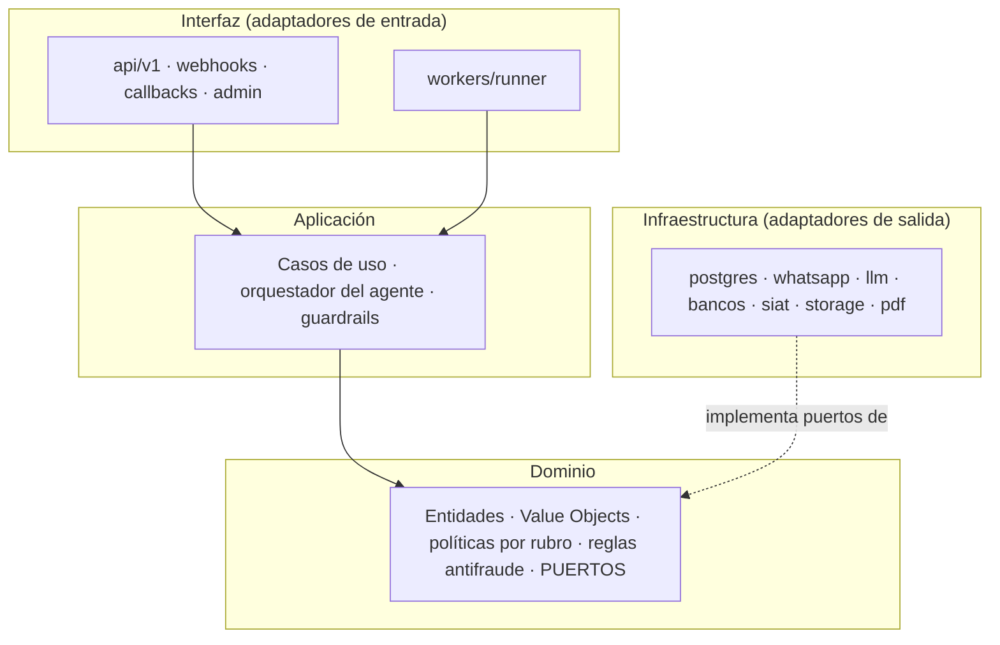
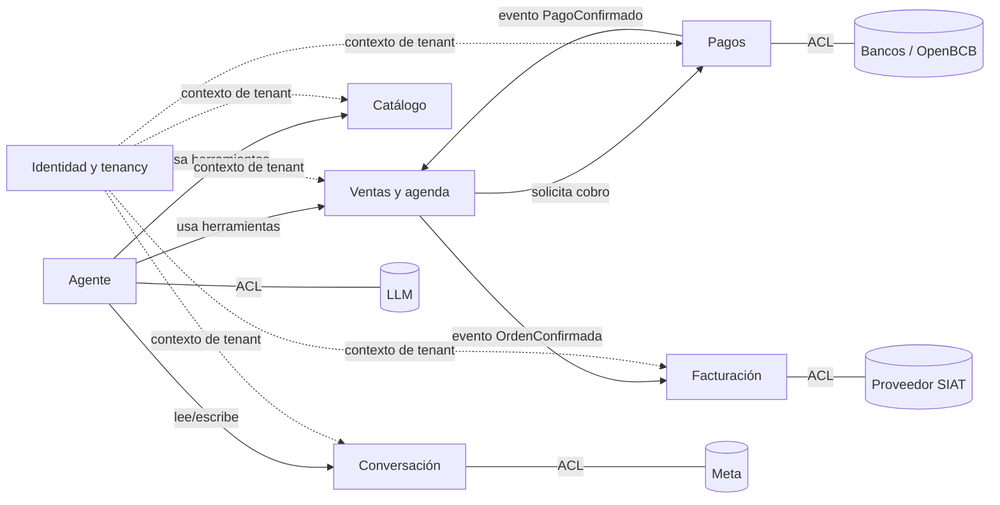

# Estilo arquitectónico, principios SOLID y patrones de diseño

| Campo | Valor |
| :--- | :--- |
| Documento | Vista de principios y patrones (complementa `SYSTEM_DESIGN.md`) |
| Versión | 1.0 · 15-oct-2026 |
| Estándares de referencia | ISO/IEC/IEEE 42010:2022 (descripción de arquitectura) · arc42 · Modelo C4 · UML 2.5.1 · ISO/IEC 25010 · OWASP ASVS / OWASP Top 10 para aplicaciones LLM |

## 1. Tipo de arquitectura

SCZ-B2B-Core es un **monolito modular** con **arquitectura hexagonal** (puertos y adaptadores), organizado en **capas limpias** y con **procesamiento asíncrono orientado a mensajes** sobre una cola durable. La multi-tenencia usa el modelo de **base de datos compartida con aislamiento por fila** (RLS).

| Dimensión | Elección | Por qué (y ADR) |
| :--- | :--- | :--- |
| Estilo de despliegue | Monolito modular, 2 procesos (API y Worker) | Equipo pequeño, bajo costo operativo y límites de módulo claros que permiten extraer servicios después (ADR-0001) |
| Estilo de código | Hexagonal + Clean Architecture | El dominio no depende de Meta, del LLM, del banco ni de la BD; cada integración se puede cambiar (ADR-0001) |
| Comunicación interna | Asíncrona por cola durable + outbox | Ack ≤ 250 ms, reintentos, orden por conversación (ADR-0005) |
| Datos | PostgreSQL compartido, RLS por tenant, invariantes en el motor | Aislamiento y exactitud garantizados por el motor, no por la disciplina del código (ADR-0002, 0004, 0007) |
| Dashboard | Cliente-servidor (Next.js) con lectura directa vía RLS y comandos sensibles por RPC o API | Separación de lecturas y comandos (CQRS ligero) |
| Integraciones | Capa anticorrupción por proveedor | Los modelos de Meta, de los bancos y del SIAT no contaminan el dominio |

### 1.1 Capas y regla de dependencias



**Regla:** las flechas de dependencia solo apuntan hacia el dominio. `domain/` no importa nada de `application/`, `infrastructure/` ni `api/`, ni bibliotecas de terceros salvo la estándar y `pydantic` para los *value objects*. Lo verifica `import-linter` en CI.

### 1.2 Contextos acotados (DDD estratégico)

| Contexto | Responsabilidad | Agregados principales | Integra con |
| :--- | :--- | :--- | :--- |
| Identidad y tenancy | Organizaciones, membresías, roles, canales | `Organization`, `Membership` | Supabase Auth |
| Conversación | Mensajes, ventana de 24 h, modo bot/humano, outbox | `Conversation`, `Message` | WhatsApp (ACL) |
| Catálogo | Ítems, búsqueda, embeddings | `CatalogItem` | Proveedor de embeddings (ACL) |
| Ventas y agenda | Órdenes, cotizaciones, citas, stock, FSM, IVA, TC | `Order`, `StockReservation`, `Resource` | — |
| Pagos | Evidencias, confirmaciones, libro de pagos | `PaymentEvidence`, `Payment` | Bancos / OpenBCB (ACL) |
| Facturación | Facturas y estados del SIAT | `Invoice` | Proveedor SIAT (ACL) |
| Agente | Turnos, herramientas, guardrails, evals | `AgentTurn` (efímero) | LLM (ACL) |



---

## 2. Revisión SOLID

Se evaluó el diseño v2 (documentos + esquema ejecutable) contra cada principio. Cuando hay una desviación deliberada, se documenta junto con su justificación y cómo se controla.

| Principio | Cómo se aplica | Evidencia | Brecha / riesgo | Acción |
| :--- | :--- | :--- | :--- | :--- |
| **S — Responsabilidad única** | Un caso de uso por intención (`HandleInboundMessage`, `RunAgentTurn`, `VerifyPaymentEvidence`, `ConfirmBankPayment`, `IssueInvoice`). La API solo recibe y persiste; el worker procesa | §4.3 del diseño; ADR-0001 | La tabla `orders` sirve a `SALE` y `APPOINTMENT`. La RPC `create_quote` valida, calcula y reserva | Aceptado: el discriminador `kind` y la FSM por tipo mantienen la cohesión. `create_quote` es un *Transaction Script* atómico por diseño (ver §3.2) y delega cálculos en funciones puras (`unit_price_bs`, `tax_breakdown`). Separar `appointments` si los flujos divergen más |
| **O — Abierto/cerrado** | Nuevos rubros = nuevo `VerticalPolicy` (Strategy). Nuevos bancos = nuevo adaptador de `PaymentPort`. Nuevas transiciones = filas en `fsm_transitions`. Nuevo régimen de IVA = fila en `tax_regimes` | ADR-0004, 0008, 0012; §7.3 | Un estado nuevo exige migrar el enum | Aceptado: un estado nuevo es un cambio de reglas de negocio y debe pasar por revisión |
| **L — Sustitución de Liskov** | Todo adaptador de un puerto cumple el mismo contrato: idempotencia, errores tipados y *timeouts* | Suite de **pruebas de contrato** compartida por adaptador (§13.1) | La notificación de OpenBCB y el webhook del BNB tienen semánticas distintas | El adaptador normaliza todo a `PaymentConfirmed(order_ref, amount, bank_txn_id, occurred_at)` y la misma suite corre contra cada adaptador |
| **I — Segregación de interfaces** | Puertos pequeños por capacidad | Ver §2.1 | La v1 tenía un único `LLMPort` y un único `MessagingPort` | Divididos: `ChatModel`, `VisionExtractor`, `Embedder`, `SpeechToText`; `OutboundMessenger`, `MediaGateway`, `TemplateCatalog` |
| **D — Inversión de dependencias** | Aplicación y dominio dependen de `Protocol`s; la composición ocurre solo en `main.py` y `worker.py` (*composition root*); sin *service locator* | `import-linter`; inyección por constructor | Las invariantes viven en SQL, fuera del dominio Python | Desviación deliberada (defensa en profundidad): la BD es la **última palabra** sobre dinero, stock, agenda y estados, y Python valida antes para dar mensajes claros. Las pruebas de paridad (FSM) y de propiedades (dinero) impiden que diverjan |

### 2.1 Puertos (interfaces) segregados

```python
# domain/ports.py — contratos; sin dependencias de infraestructura
from typing import Protocol, Sequence
from uuid import UUID
from decimal import Decimal

class ChatModel(Protocol):
    async def run_turn(self, system: str, history: Sequence["ChatMessage"],
                       tools: Sequence["ToolSpec"], *, timeout_s: float) -> "ModelResponse": ...

class VisionExtractor(Protocol):
    async def extract_receipt(self, image: bytes, *, timeout_s: float) -> "ReceiptExtraction": ...

class Embedder(Protocol):
    async def embed(self, texts: Sequence[str]) -> Sequence[Sequence[float]]: ...

class SpeechToText(Protocol):
    async def transcribe(self, audio: bytes, mime: str) -> str: ...

class OutboundMessenger(Protocol):
    async def send(self, msg: "OutboundMessage", *, idempotency_key: str) -> "SendReceipt": ...

class PaymentProvider(Protocol):
    async def create_charge(self, order_ref: str, amount_bs: Decimal, expires_in_s: int) -> "ChargeQR": ...
    async def verify(self, notification: "RawNotification") -> "PaymentConfirmed | None": ...

class BillingProvider(Protocol):
    async def issue(self, invoice: "InvoiceRequest", *, idempotency_key: str) -> "InvoiceResult": ...

class UnitOfWork(Protocol):          # abre la transacción y fija tenant + actor (ADR-0011)
    async def __aenter__(self) -> "UnitOfWork": ...
    async def __aexit__(self, *exc: object) -> None: ...
    orders: "OrderRepository"; catalog: "CatalogRepository"; conversations: "ConversationRepository"
```

### 2.2 Otros principios aplicados

| Principio | Aplicación concreta |
| :--- | :--- |
| **DRY / fuente única de verdad** | Precio: una función SQL. FSM: una tabla. Esquema: las migraciones. Requisitos: `docs/requirements/SRS.md` |
| **KISS / YAGNI** | Sin microservicios, sin Kafka, sin BD vectorial externa; la cola vive en Postgres |
| **Fail fast / falla cerrado** | Sin tenant no se ve nada; sin TC vigente no se cotiza en USD; con una firma inválida se rechaza el webhook |
| **Mínimo privilegio** | `app_backend` sin BYPASSRLS ni DELETE; roles OWNER/ADMIN/STAFF/AUDITOR; MFA para operaciones sensibles |
| **Defensa en profundidad** | Validación Pydantic → reglas de dominio → RLS, FSM y restricciones del motor |
| **Seguro por defecto** | Buckets privados; nada expuesto a `anon`; `search_path` fijo |
| **Idempotencia** | Webhooks, jobs, envíos y facturas con clave idempotente |
| **12-Factor App** | Configuración por entorno, procesos sin estado, logs como flujo, paridad dev/prod con Supabase local |
| **Ley de Demeter** | Los casos de uso hablan con puertos y repositorios, nunca con el cliente HTTP de un proveedor |

---

## 3. Catálogo de patrones de diseño

### 3.1 Patrones GoF (diseño de objetos)

| Patrón | Dónde | Para qué |
| :--- | :--- | :--- |
| **Strategy** | `VerticalPolicy` (importadora, clínica); selección de `PaymentProvider` por tenant | Cambiar el comportamiento por rubro o banco sin condicionales dispersos |
| **Adapter** | `infrastructure/*` (WhatsApp, LLM, bancos, SIAT, Storage) | Traducir APIs externas a los puertos del dominio |
| **Abstract Factory / Factory Method** | `ProviderFactory` (crea adaptadores según la config del tenant); `PromptFactory` | Centralizar la construcción y la validación de la configuración |
| **State** (dirigido por tabla) | FSM de órdenes (`fsm_transitions` + `tg_orders_guard`) | Transiciones explícitas y auditables, con el actor como parte de la regla |
| **Chain of Responsibility** | Pipeline antifraude: `HashRule → PerceptualHashRule → AmountRule → BeneficiaryRule → DateWindowRule → ConfidenceRule` | Reglas independientes, ordenadas y extensibles; cada una devuelve aprobado, rechazado o requiere revisión con su motivo |
| **Specification** | Reglas antifraude y de agenda como predicados combinables | Reglas legibles y testeables |
| **Decorator** | `RetryingMessenger`, `CircuitBreakerChatModel`, `TracedPort`, `CostMeteredChatModel` | Agregar reintento, corte de circuito, trazas y medición de costo sin tocar los adaptadores |
| **Command** | Cada *tool call* es un comando tipado (`CreateQuoteCommand`) validado antes de ejecutarse | Separar la intención del LLM de su ejecución; auditar |
| **Facade** | `AgentToolbox` (expone al LLM solo las herramientas permitidas); `UnitOfWork` | Una superficie mínima y segura |
| **Observer** (eventos de dominio) | `PagoConfirmado`, `OrdenConfirmada`, `EvidenciaRequiereRevision` → manejadores (notificación, factura) | Desacoplar los efectos secundarios |
| **Template Method** | `AgentTurn`: cargar contexto → llamar al modelo → ejecutar herramientas → guardrails → responder | Esqueleto fijo con pasos variables por rubro |

### 3.2 Patrones de arquitectura de aplicaciones empresariales (Fowler, PoEAA)

| Patrón | Dónde |
| :--- | :--- |
| **Repository** | Un repositorio por agregado (`OrderRepository`, `CatalogRepository`…) |
| **Unit of Work** | Transacción + `SET LOCAL` de tenant y actor (ADR-0011) |
| **Service Layer** | Casos de uso en `application/` |
| **Transaction Script** | RPCs atómicas (`create_quote`, `hold_appointment`, `approve_payment_evidence`): lógica de invariantes que debe ejecutarse en una sola transacción |
| **Value Object** | `Money(amount: Decimal, currency)`, `FxRate`, `TaxBreakdown`, `Slot`, `WaId` |
| **Identity Field / Natural key** | UUID + `reference_code` legible por tenant |
| **Pessimistic Offline Lock** | `SELECT … FOR UPDATE` ordenado en la cotización |
| **Gateway** | Clientes HTTP de proveedores encapsulados en adaptadores |
| **DTO** | Esquemas Pydantic de entrada y salida de las herramientas y la API |

### 3.3 Patrones de integración y de nube (EIP / Azure Architecture Center)

| Patrón | Dónde |
| :--- | :--- |
| **Transactional Outbox** | `private.outbound_messages` |
| **Idempotent Receiver** | `private.inbound_events` (PK = `wa_message_id`) |
| **Competing Consumers** | Workers con `FOR UPDATE SKIP LOCKED` |
| **Aggregator / Debounce** | Un trabajo `QUEUED` por conversación; agrupa ráfagas |
| **Dead Letter Channel** | Estado `DEAD` + alerta |
| **Retry con backoff exponencial** | `finish_job` (tope de 10 min) |
| **Lease / visibility timeout** | `requeue_stale_jobs` |
| **Circuit Breaker** | Decorador sobre los adaptadores del LLM, de Meta y de los bancos |
| **Bulkhead** | API y Worker en procesos separados; concurrencia acotada por tipo de trabajo |
| **Claim Check** | El medio se guarda en Storage y la cola solo lleva la referencia |
| **Valet Key** | URLs firmadas de corta vida para el dashboard |
| **Anti-Corruption Layer** | Adaptadores de Meta, bancos, SIAT y LLM |
| **Rate Limiting / Throttling** | Por cliente, por tenant y por proveedor |
| **Health Endpoint Monitoring** | `GET /v1/health` (liveness) y `/v1/ready` (BD, cola) |
| **Strangler Fig** (futuro) | Extraer el OCR u otro módulo detrás de su puerto sin reescribir los casos de uso |

### 3.4 Patrones de seguridad y de IA

| Patrón | Dónde |
| :--- | :--- |
| **Gatekeeper** | El webhook valida firma, tamaño y esquema antes de tocar el dominio |
| **Row-level multi-tenancy (pool model)** | RLS + FK compuestas |
| **Human-in-the-loop** | Aprobación de evidencias de pago; traspaso a humano |
| **Tool use con *grounding* del lado del servidor** | El LLM elige la acción; la BD calcula y decide |
| **Guardrails de entrada y salida** | Validación de herramientas; *grounding* numérico; alcance del negocio (política de Meta) |
| **Structured Output** | OCR con esquema JSON validado |
| **Retrieval híbrido (RRF)** | `search_catalog` |
| **Evaluación continua (evals)** | `evals/` en CI |

### 3.5 Antipatrones que el diseño evita explícitamente

| Antipatrón | Cómo se evita |
| :--- | :--- |
| *Distributed monolith* | No hay microservicios prematuros |
| *Anemic domain + fat controller* | La lógica vive en casos de uso y políticas, no en los endpoints |
| *Shared mutable config* | Configuración del tenant validada y versionada |
| *Magic numbers* en dinero | `Decimal`, funciones únicas de cálculo, tablas de TC e IVA |
| *Trusting the LLM* | El LLM no calcula, no confirma y no ve otros tenants |
| *Fire-and-forget background tasks* | Cola durable con reintentos (ADR-0005) |
| *God service role* | La *service role* solo vive en el `StorageAdapter` |

---

## 4. Conformidad con estándares de documentación

### 4.1 ISO/IEC/IEEE 42010 (descripción de arquitectura)

| Elemento 42010 | Dónde está |
| :--- | :--- |
| Partes interesadas y sus intereses (*concerns*) | `docs/requirements/SRS.md` §2 |
| Puntos de vista y vistas | Contexto y contenedores (C4), lógica (UML de clases), procesos (secuencia y actividad), despliegue, datos (ER), seguridad (STRIDE) — `SYSTEM_DESIGN.md` §4–8 y `docs/architecture/uml.md` |
| Correspondencias entre vistas | Matriz de trazabilidad (`SRS.md` §6) |
| Justificación (*rationale*) | ADR-0001 … ADR-0015 |

### 4.2 Mapa arc42

| Sección arc42 | Documento |
| :--- | :--- |
| 1 Introducción y objetivos | `SYSTEM_DESIGN.md` §1–2 · `SRS.md` |
| 2 Restricciones | `SYSTEM_DESIGN.md` §1.3 · `docs/research/2026-10-15-restricciones-externas.md` |
| 3 Contexto y alcance | `SYSTEM_DESIGN.md` §4.1 · `uml.md` (casos de uso) |
| 4 Estrategia de solución | Este documento §1 · ADRs |
| 5 Vista de bloques | `SYSTEM_DESIGN.md` §4.2–4.3 · `uml.md` (componentes y clases) |
| 6 Vista de ejecución | `SYSTEM_DESIGN.md` §4.4–4.5 · `uml.md` (actividad) |
| 7 Vista de despliegue | `uml.md` (despliegue) · ADR-0010 |
| 8 Conceptos transversales | Seguridad §8, operación §10, este documento §2–3 |
| 9 Decisiones | `docs/adr/` |
| 10 Requisitos de calidad | `SYSTEM_DESIGN.md` §2 |
| 11 Riesgos y deuda técnica | `SYSTEM_DESIGN.md` §14 · registro de restricciones externas |
| 12 Glosario | `SYSTEM_DESIGN.md` §15 |

### 4.3 Otras normas y convenciones

* **ISO/IEC/IEEE 29148** — especificación de requisitos con identificadores, prioridad y criterios de aceptación: `docs/requirements/SRS.md`.
* **ISO/IEC 25010** — modelo de calidad: `SYSTEM_DESIGN.md` §2.
* **UML 2.5.1** — diagramas de casos de uso, clases, componentes, despliegue, actividad, secuencia y estados (en Mermaid, que GitHub renderiza).
* **OWASP ASVS (nivel 2 como objetivo)** y **OWASP Top 10 para aplicaciones LLM** — checklist de verificación de seguridad por fase.
* **MADR** para ADRs · **Conventional Commits** · **SemVer** · **Keep a Changelog**.
