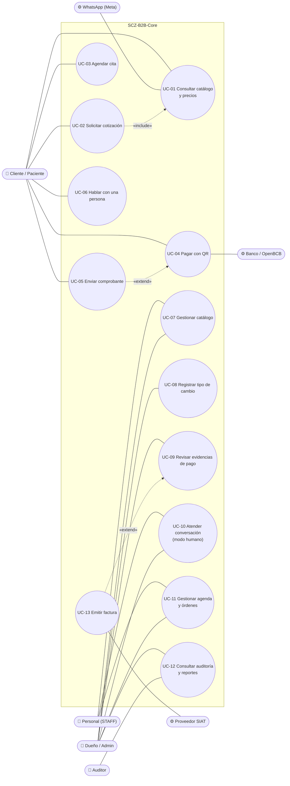
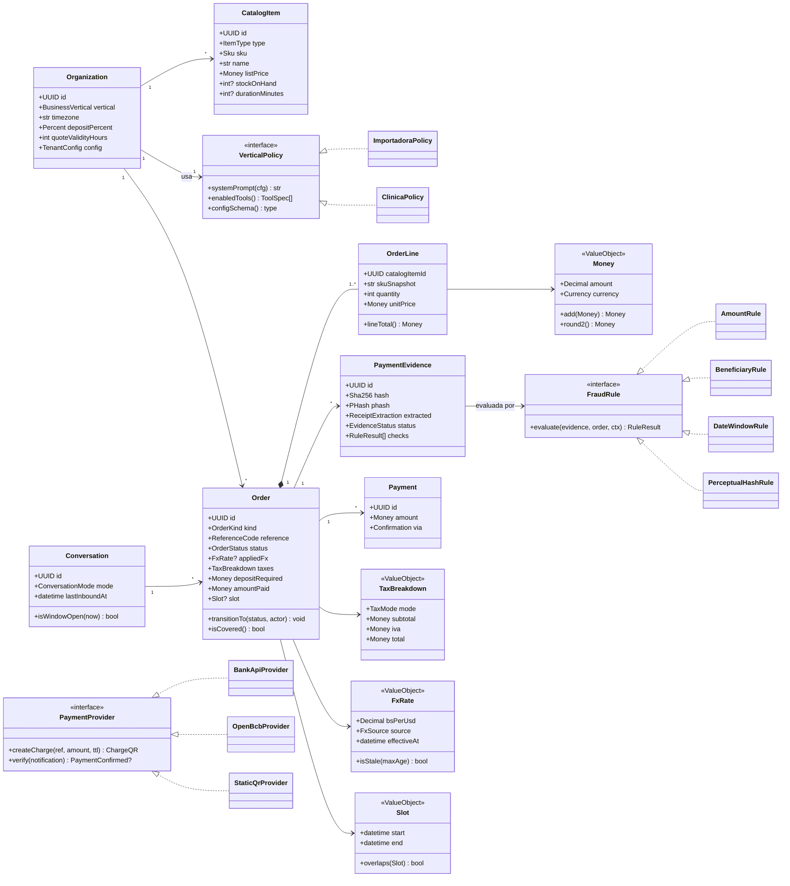
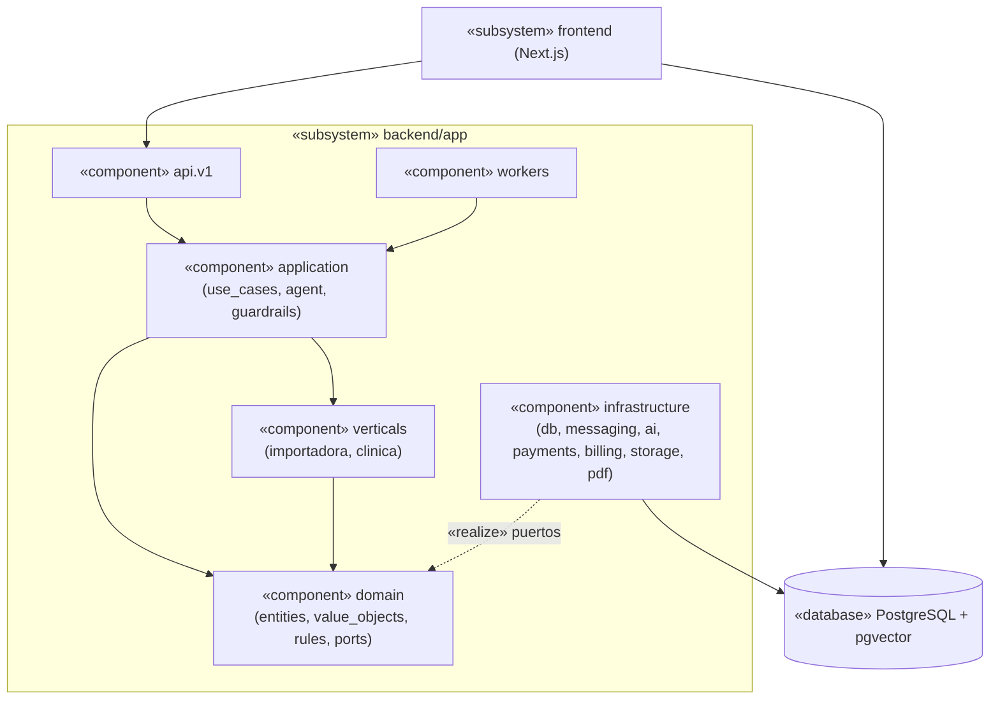
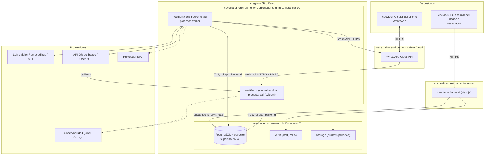
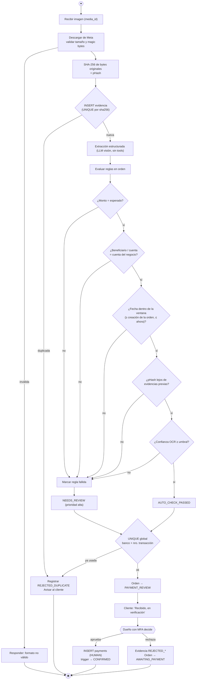
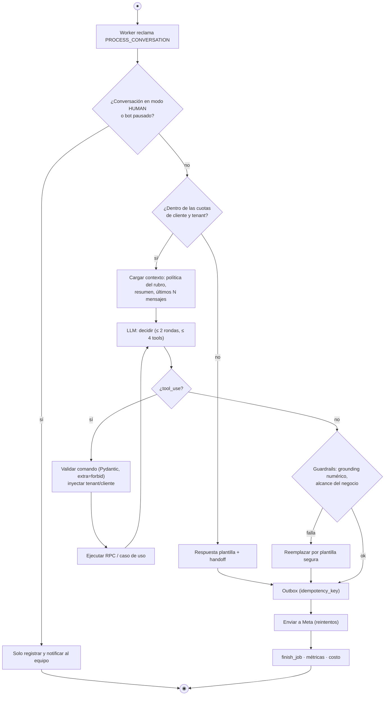
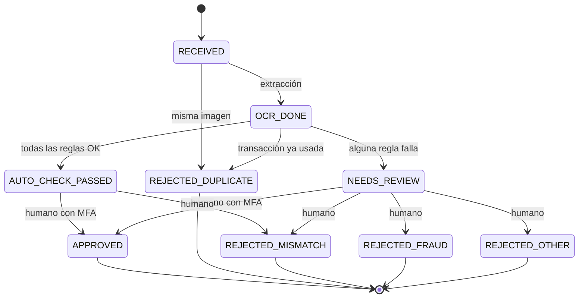
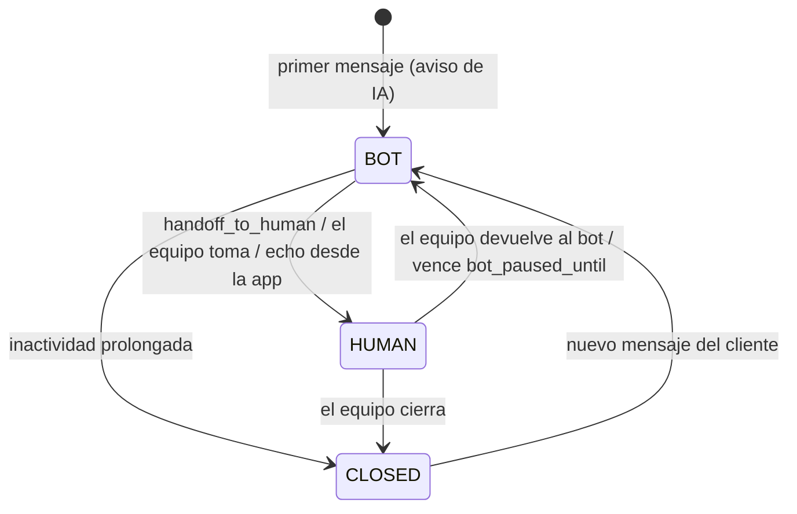
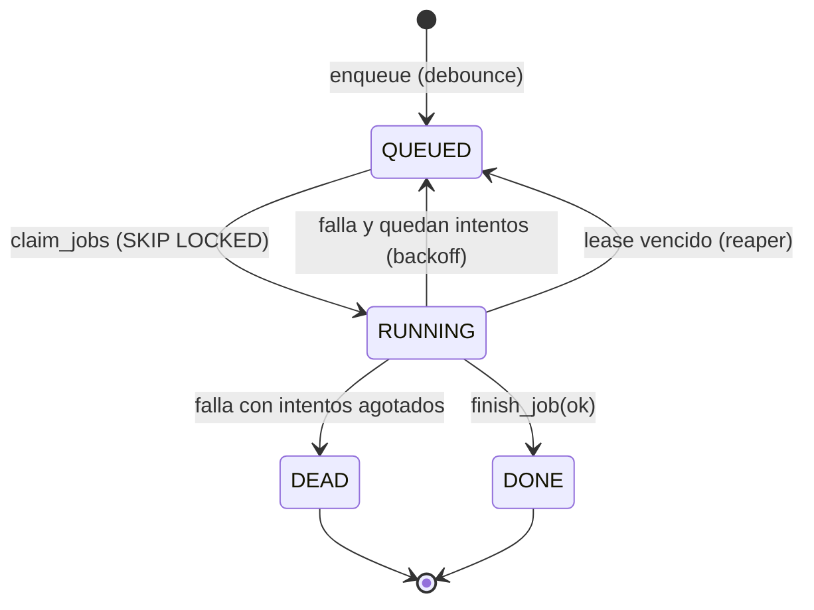
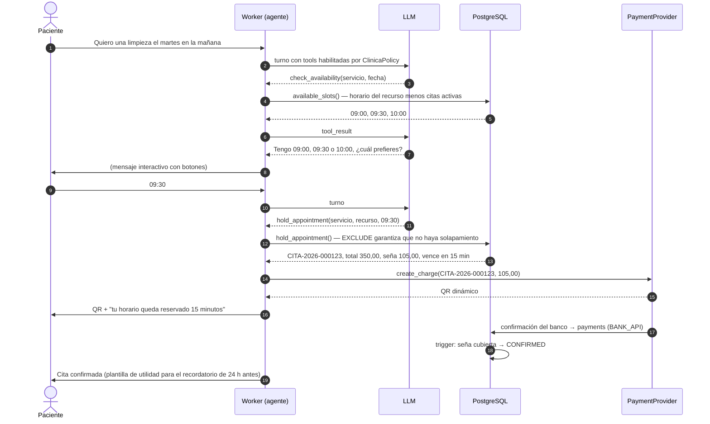

# Modelos UML

Diagramas UML 2.5.1 expresados en Mermaid (GitHub los renderiza). Las vistas de contexto y contenedores (C4), la secuencia de mensajes y pagos, la FSM de órdenes y el modelo entidad-relación están en `SYSTEM_DESIGN.md` §4–6. Aquí van las vistas que faltaban: casos de uso, clases del dominio, despliegue, actividad y estados auxiliares.

> Convención: los nombres en inglés corresponden al código; las descripciones están en español. Cada diagrama cita los requisitos (`RF-xx`) del `docs/requirements/SRS.md` que modela.

## 1. Diagrama de casos de uso

## 2. Diagrama de clases del dominio

Modela los agregados, *value objects*, políticas y puertos (RF-02…RF-12).

## 3. Diagrama de componentes y paquetes

## 4. Diagrama de despliegue

## 5. Diagrama de actividad — verificación de un comprobante (camino B)

Modela RF-08 y ADR-0008. Cada regla es un eslabón de la *Chain of Responsibility*.

## 6. Diagrama de actividad — turno del agente

Modela RF-01…RF-04 y §7 del diseño (*Template Method*).

## 7. Diagramas de estados auxiliares

### 7.1 Evidencia de pago

### 7.2 Conversación

### 7.3 Trabajo de la cola

## 8. Diagrama de secuencia — agendar una cita con seña

Modela RF-05 y RF-06.

